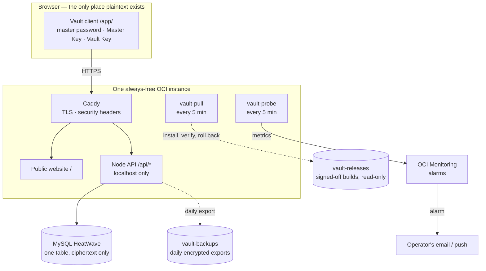
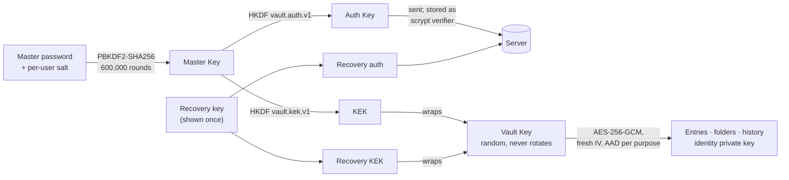
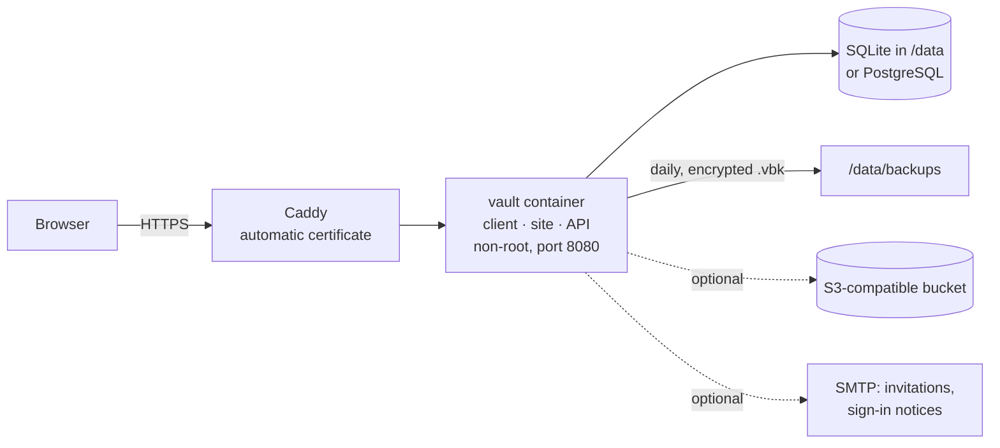
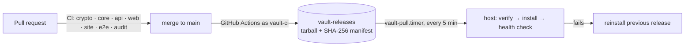
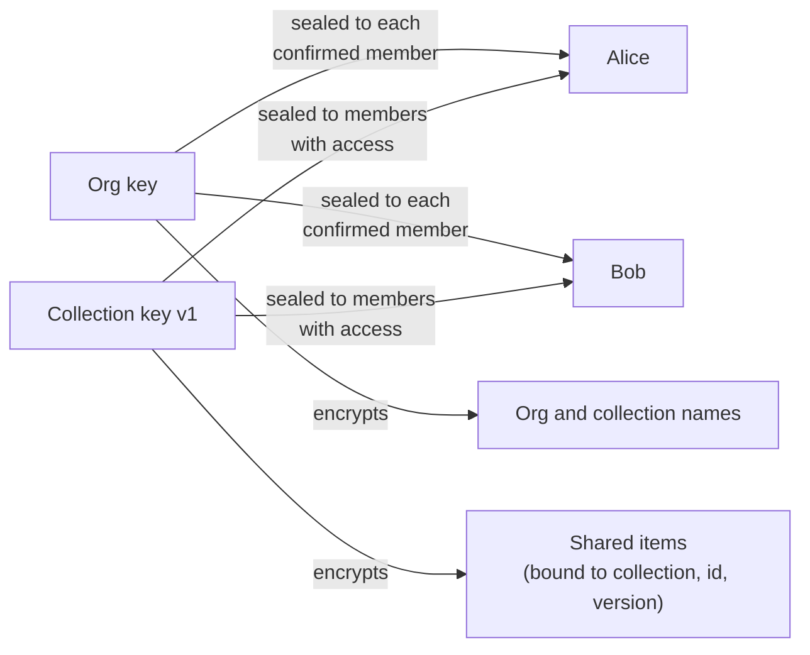
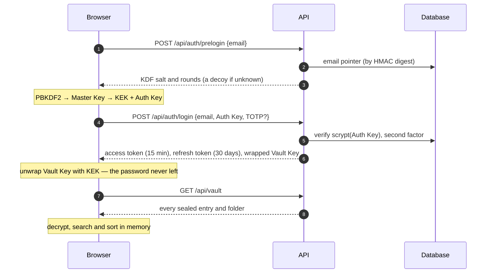

# Architecture

One always-free virtual machine, one always-free MySQL HeatWave database holding a single
table, object storage for backups and releases. No
CDN, no serverless functions, no second provider. (That is the reference instance. A
self-hosted install can use SQLite or PostgreSQL instead —
[0012](decisions/0012-storage-drivers-and-migrations.md).) The whole system is small enough that a
new reader can hold all of it at once, which is deliberate.

This describes the system as built. [STATUS.md](STATUS.md) is the running log, [docs/ROADMAP.md](docs/ROADMAP.md) the plan, and [docs/KNOWN-ISSUES.md](docs/KNOWN-ISSUES.md) the limits.

The reasoning lives in [`decisions/`](decisions/): [0001](decisions/0001-cryptography-and-key-hierarchy.md)
for the cryptographic scheme, [0002](decisions/0002-storage-and-data-model.md) for the
data model, [0003](decisions/0003-running-everything-on-oci.md) for why everything sits on
one provider, and [docs/threat-model.md](docs/threat-model.md) for the adversaries the
shape is chosen against.

## Shape



<details>
<summary>The same picture as text, for tools that do not render diagrams</summary>

```
        Browser  ── master password, Master Key, Vault Key, plaintext
           │        all live here and nowhere else
           │  HTTPS
           ▼
   ┌──────────────────────────────────────────┐
   │  One always-free instance                │
   │  Caddy ──┬── /       → public site       │
   │          ├── /app/*  → vault client      │
   │          └── /api/*  → Node, localhost   │
   └──────────────────────────┼───────────────┘
              ┌───────────────┴───────────────┐
              ▼                               ▼
      MySQL HeatWave                  Object Storage
      ciphertext only                 vault-backups   daily encrypted exports (write)
                                      vault-releases  what the host serves (read-only)

      OCI Monitoring ◄── health metrics every 5 min (vault-probe)
           │  alarms, including one on the metrics going missing
           ▼
      Notifications ──► operator's email (optionally an HTTPS push endpoint)
```

</details>

Caddy terminates TLS with a certificate it obtains itself, serves the public site and the
client from disk, sets every security header, and proxies `/api/*` to the Node process beside it. The client
and the API therefore share an origin with nothing in front of them — which is what lets
the Content-Security-Policy restrict `connect-src` to `'self'`.

The instance authenticates to Object Storage **as itself**, through a dynamic group that
matches its OCID. The database is reached inside the VCN with a password that, like the
email pepper and the token signing key, lives in `/srv/vault/api/run/secrets.env` on the
host and never in the repository.

**Monitoring** is a probe on the host (`services/monitor`) that checks the service through
public DNS and the host from inside, and posts the results as custom metrics; thresholds
live in Terraform as alarms (`infra/monitoring.tf`). A dead host cannot report itself, so
one alarm fires on the metrics' absence. Everything used is in OCI's always-free allowance.

## Where trust ends

Everything below the browser is assumed hostile. A complete compromise of the server
should yield ciphertext and nothing more.

That assumption drives three choices that would otherwise look excessive:

- The master password is never transmitted. The server receives an **Auth Key**, a
  separate HKDF branch of the Master Key, and stores only an scrypt verifier of it.
- All entry content is encrypted client-side, including names, tags, and folder names.
  The server cannot read, search, or index any of it.
- Email addresses are stored as HMAC digests under a pepper kept outside the database, so
  a dump does not identify account holders.

**One thing sits outside that boundary and should be understood plainly.** The hostname is
a free dynamic-DNS name, and it is the whole user-facing trust path. Whoever controls that
name can obtain a certificate for it and serve their own JavaScript — which sees the
master password. Unlike a compromise of the server, that is not bounded by the key
hierarchy. It is accepted knowingly; see A3 in the threat model.

## Key hierarchy



<details>
<summary>As text</summary>

```
Master Password + per-user salt
        │ PBKDF2-SHA256, 600k
        ▼
   Master Key ──┬── HKDF "vault.kek.v1"  ──► KEK ──► wraps Vault Key
                └── HKDF "vault.auth.v1" ──► Auth Key ──► server (scrypt verifier)

   Vault Key (random, generated once, never rotates)
        ├── wrapped by KEK                  (master password path)
        ├── wrapped by Recovery KEK         (recovery key path)
        └── encrypts every entry field, AES-256-GCM, fresh 96-bit IV
```

</details>

Each account also has an **identity key pair** (ECDH P-256): the public key in the clear on the
profile, the private key sealed under the Vault Key. It is what sharing will use to hand a
collection key to a colleague without the server learning it
([0009](decisions/0009-identity-keys-and-sharing.md)).

The indirection through the Vault Key is what makes a master password change a **single
write**: re-derive the KEK, rewrap the Vault Key, store the new salt and verifier. Entries
are untouched and history survives.

**Exports** use a key of their own: PBKDF2 over a password the user picks at export time,
then HKDF (`vault.export.key.v1`), sealing the items with AAD `vault.export.v1`. The file
carries its salt and iteration count, so it opens on any Vault server with only that password
and is unrelated to the account's keys. Imports happen in the browser: a file is parsed by
`packages/core`, sealed under the Vault Key, and sent to `POST /api/vault/import`, which only
creates and never overwrites.

The recovery key has a second branch of its own, `vault.recovery.auth.v1`, so it can prove
itself to the server without revealing the branch that unwraps the vault. Recovery happens
exactly when the master password is gone, so the usual Auth Key cannot be produced.

## Self-hosted installs

The same code, packaged ([0013](decisions/0013-distribution-and-releases.md)). One image runs
one Node process that serves the client, the website and the API (`SERVE_STATIC`), with the
reference Caddyfile's headers; Caddy in front only terminates TLS.



On first start the server generates its secrets into `/data/secrets.env`, migrates the
database, and — if no account exists — prints a one-time setup link that creates the owner.
Releases are images built for amd64 and arm64 on a version tag, with an SBOM and provenance,
signed keylessly with Sigstore. Install guide: [docs/INSTALL.md](docs/INSTALL.md).

## Releases

Code reaches the host by the host pulling it ([0005](decisions/0005-pull-based-releases.md)).
`scripts/release.sh` uploads a tarball — site, client, API bundle, Caddyfile, and a SHA-256
manifest — to `vault-releases` and points the `current` object at it. On the host,
`vault-pull.timer` checks every five minutes, verifies the hash and the manifest, validates
the Caddyfile, installs, checks the service through Caddy, and reinstalls the previous
release if anything fails. Nothing inbound is involved; SSH stays closed.



Releases are published by GitHub Actions on every merge to `main`
([0008](decisions/0008-release-pipeline.md)), as `vault-ci`, an OCI user that can write the
releases bucket and nothing else. Write access to that bucket — and so push access to
`main` — decides what browsers run, so it carries the same weight as the hostname (A3). The
host can only read it.

## The website

The public site is templates, a content schema and content ([0007](decisions/0007-roles-and-site-editing.md)).
Templates ship in each release under `api/site/`; content is edited in the admin panel and
stored in the `SYSTEM` partition. When content is published — and once at every API start —
the API renders the templates with the live content into `/srv/vault/site/v-<ts>/` and swaps
the `current` symlink, which is what Caddy serves at `/`. Uploaded images are stored in the
table and written to `/srv/vault/site/media/`. The renderer escapes every value and accepts
no markup, because the site shares an origin with the vault client.

## Organizations and sharing

Built on the identity keys every account has ([0009](decisions/0009-identity-keys-and-sharing.md),
[0015](decisions/0015-organizations-and-collections.md)).



Members are invited by address digest, accept, and are confirmed by an admin comparing their
key fingerprint out of band; only then is anything sealed to them. The server enforces
view / edit / manage per collection and serves ciphertext; it holds no key that opens any of it.
Removal re-keys collections (new version, items re-encrypted, re-sealed); groups grant
collections to sets of members; policies gate access; an audit log records who did what; and
emergency access lets a trusted contact read a vault after a waiting period
([0016](decisions/0016-teams-completion.md)).

## Service desk

Help and support inside the product ([0014](decisions/0014-service-desk.md)): public
requests from the sign-in screen (access, sign-in help), support tickets from signed-in users,
and a queue in the admin panel with replies, internal notes, status, priority, assignment, and
two actions — approve access (issues and emails an invitation) and reset two-factor sign-in.
Requester addresses are kept only while a ticket is open.

## Administration

The operator manages the service from an admin panel inside the client, at `/app/admin`
([0006](decisions/0006-admin-panel.md), [0007](decisions/0007-roles-and-site-editing.md)).
Access is by role on a normal account: owners are the addresses in `ADMIN_EMAILS`, kept as
digests; owners grant admin, marketing and viewer, stored on the account's registry row.
Every admin request re-reads the caller's role and checks the permission the route needs. The panel can set registration to closed, invite-only or open, issue
single-use invitations, list accounts with their counts and dates, label, sign out,
disable or delete them, show the last recorded backup, and read an audit log. It cannot read
a vault or show an address — there is nothing readable on the server for it to show.

## Data

One table. One partition per user. No secondary indexes, because the only two reads are a
shard-key query and a point lookup. The same table exists in MySQL, PostgreSQL or SQLite;
a `vault_meta` table beside it records the schema version.

| `pk` | `sk` | Holds |
|---|---|---|
| `USER#<id>` | `PROFILE` | KDF parameters, auth verifier, both wrapped Vault Keys |
| `USER#<id>` | `ENTRY#<id>` | One encrypted entry |
| `USER#<id>` | `FOLDER#<id>` | Encrypted folder name and parent |
| `USER#<id>` | `HIST#<entryId>#<ts>` | Prior versions, capped at twenty, sealed with their own AAD so the server cannot swap one in as the live entry |
| `USER#<id>` | `ACT#<ts>#<rand>` | Activity record, expires itself |
| `USER#<id>` | `SESSION#<tokenId>` | A live refresh token: its device id (`sid`, stable across rotation), device description, address, optional name; expires itself |
| `EMAIL#<hmac>` | `EMAIL` | Login pointer to a user id |
| `SYSTEM` | `SETTINGS` | Registration mode; absent means closed |
| `SYSTEM` | `USER#<id>` | Registry row for the admin panel: digest, dates, label, disabled |
| `SYSTEM` | `INVITE#<sha256>` / `INVITEUSED#<sha256>` | An invitation, by the hash of its code, and its single-use claim |
| `SYSTEM` | `AUDIT#<ts>#<rand>` | An admin action, expires after a year |
| `SYSTEM` | `BACKUP` | The last verified export, written by the backup script |
| `SYSTEM` | `SITE#DRAFT` / `SITE#LIVE` / `SITE#V#<version>` | Website draft, pointer to the live version, and the last 30 published versions |
| `SYSTEM` | `MEDIA#<id>` / `MEDIAMETA#<id>` | An uploaded image (bytes, base64) and its metadata |
| `DESK` | `TICKET#<id>` / `SEQ` | A service desk ticket (kind, status, requester — email only while open) / the ticket number counter |
| `DESKT#<id>` | `MSG#<seq>` | One message on a ticket, numbered; staff notes flagged internal |
| `USER#<id>` | `TICKET#<id>` | Pointer to a ticket the user opened |
| `ORG#<id>` | `META` / `MEMBER#<user>` / `PENDING#<digest>` | Organization (name sealed under the org key) / a member: role, status, recorded public key, sealed org key / an invitation not yet accepted |
| `ORG#<id>` | `COLL#<coll>` / `ACCESS#<coll>#<user>` | A collection: name sealed under the org key, key version / a member's grant: permission, hide-passwords, collection key sealed to them |
| `COLLI#<coll>` | `ITEM#<id>` | A shared item, sealed under the collection key at a version |
| `USER#<id>` · `EMAIL#<digest>` | `ORG#<org>` · `ORGINVITE#<org>` | Pointers: my organizations; invitations waiting for an address |
| `ORG#<id>` | `GROUP#<g>` / `GACCESS#<coll>#<g>` | A group (name sealed, member ids) / a collection granted to a group |
| `ORG#<id>` | `EVENT#<ts>#<n>` | Access audit event: actor, action, collection, item id; expires after a year |
| `USER#<grantor>` | `EMGRANT#<id>` | Emergency access grant: contact, wait, status, grantor's vault key sealed to the contact |
| `EMAIL#<digest>` · `USER#<contact>` | `EMINVITE#<id>` · `EMTRUST#<id>` | Emergency invitation waiting for an address · pointer for the contact |
| `SYSTEM` | `ORG#<id>` | The operator's index of organizations |

Unlocking is one query. Everything after that — search, filter, sort, folder resolution —
happens in the client, because the server cannot read what it is storing.

## Request flow

**Registration.** The client generates a Vault Key and a recovery key, derives the Master
Key from the chosen password and a fresh salt, wraps the Vault Key twice, and sends the
salt, the Auth Key, the recovery proof, and both wrapped blobs. The recovery key is
displayed once and never transmitted.



**Login.** The client requests the salt for an email address; unknown addresses receive a
deterministic decoy, so the endpoint cannot be used to enumerate accounts. It derives the
Master Key, sends the Auth Key, receives a short-lived access token and the wrapped Vault
Key, and unwraps it locally.

**Reading.** One query returns the partition. The client decrypts in memory. Keys are
discarded on logout, tab close, and idle timeout; nothing sensitive reaches browser
storage, so a reload requires unlocking again.

**Writing.** The client encrypts, then writes the item. The server validates shape, size,
and ownership — it cannot validate content.

## Repository layout

Everything this project is lives here. Nothing about it lives anywhere else.

| Path | Contents |
|---|---|
| `packages/crypto/` | Key derivation, wrapping, entry encryption, TOTP. Zero third-party dependencies |
| `packages/crypto/vectors/` | Test vectors from RFC 6070, RFC 5869, RFC 4231, NIST, RFC 6238 |
| `packages/core/` | Shared by every client, no UI, no dependencies: the item model (what each entry type holds, folder trees, search), import parsers for other managers' files, CSV export, and QR encoding |
| `services/api/` | The API, and the storage adapters behind one interface |
| `apps/web/` | The vault client, served at `/app/`, and the Caddyfile. `src/lib` (API client, session, router), `src/ui` (kit, icons, Shell), `src/features/{auth,vault,settings,admin}` |
| `apps/site/` | The public website: templates, content schema and defaults, static files, and the renderer the build and the API share |
| `services/backup/` | The daily export and its systemd timer, and the restore drill |
| `services/monitor/` | The health probe and its timer; the alarms are in `infra/monitoring.tf` |
| `deploy/` | Self-hosted install profiles (Compose): personal and business |
| `Dockerfile` | The self-hosted image |
| `services/release/` | The host's pull agent and its systemd timer |
| `scripts/` | `release.sh` ships code (CI runs it on merge); `setup-ci.sh` creates the CI identity; `deploy.sh` sets up the host; `apply.sh` guards Terraform |
| `.github/workflows/` | `ci.yml` tests every change, including browser tests; `release.yml` publishes every merge to `main` |
| `tests/e2e/` | Browser tests: a real Chrome against `scripts/dev-stack.mjs` |
| `infra/` | Terraform for the instance, the database, both buckets, IAM, and the network |
| `decisions/` | Architecture decision records |
| `docs/` | Threat model, runbook, configuration reference, and the generated OpenAPI document |

The cryptography package is deliberately separate, dependency-free, and fully covered. It
is the one component where a defect is unrecoverable — ciphertext written under a broken
scheme cannot be repaired — and the one that a second implementation, the planned Android
client, has to match exactly. Its test vectors come from published standards rather than
from this implementation, so that "both clients agree" cannot quietly mean "both are wrong
in the same way".
