<div align="center">

# Vault

**A zero-knowledge password manager you run on your own server.**
Everything is encrypted in your browser; the server stores ciphertext it holds no key for.

[](https://github.com/SHIVAM-SHARMA-766/vault/actions/workflows/ci.yml)


[**Live instance**](https://vault-shivam.duckdns.org) · [Install your own](docs/INSTALL.md) · [User guide](docs/USER-GUIDE.md) · [Architecture](ARCHITECTURE.md) · [Roadmap](docs/ROADMAP.md)

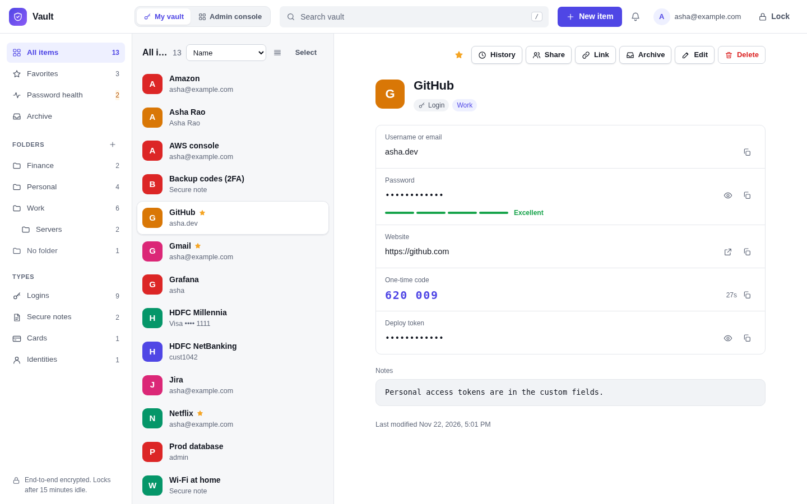

</div>

## Features

<table>
<tr>
<td width="50%" valign="top">

### 🔐 Zero-knowledge by design
Your master password never leaves the browser. Names, websites, usernames, notes, folders
and tags are encrypted along with passwords — a database dump does not even reveal which
sites you use.

</td>
<td width="50%" valign="top">

### 🗂️ Fifteen item types, nested folders
Logins, notes, cards, identities, bank accounts, passports, driving licences, memberships,
crypto wallets, API credentials, databases, servers, software licences, SSH keys and Wi-Fi,
each with its own fields; custom and hidden fields; folders four levels deep; live one-time codes.

</td>
</tr>
<tr>
<td width="50%" valign="top">

### 🩺 Password health
Weak, reused, year-old and `http://`-only passwords, scored out of 100 with advice on each
item — computed in your browser.

</td>
<td width="50%" valign="top">

### 🔁 Import from nine formats
Chrome, Edge, Brave, Firefox, Safari, Bitwarden, 1Password, LastPass, KeePass and Zoho Vault,
previewed before saving, duplicates skipped. Encrypted export to move between servers.

</td>
</tr>
<tr>
<td width="50%" valign="top">

### 🕘 History you can restore
Every edit keeps the previous version, encrypted like the item, up to twenty per item. See
the old password; restore it in one click.

</td>
<td width="50%" valign="top">

### 👥 Share with your team
Organizations, groups and collections, each with its own key, sealed to every member you confirm
by fingerprint. Permissions, policies, an audit log, key rotation and emergency access.

</td>
</tr>
<tr>
<td width="50%" valign="top">

### 🛡️ Account security
Two-factor sign-in with recovery codes, a recovery key instead of a password reset,
signed-in devices you can name and sign out, and ninety days of security activity.

</td>
<td width="50%" valign="top">

### 🧑‍💼 Admin panel and service desk
Roles, invitations, an audit log and a website editor — plus a built-in help desk for access
requests, lost authenticators and support tickets. None of it can read a vault.

</td>
</tr>
<tr>
<td width="50%" valign="top">

### 🏠 Runs on your server
One container, SQLite or PostgreSQL, HTTPS by Caddy. A setup link creates the owner,
secrets generate themselves, and encrypted backups go to disk or any S3-compatible store.

</td>
<td width="50%" valign="top">

### 🧾 Backups that restore anywhere
One encrypted file holds everything; restore it onto SQLite or PostgreSQL, from disk or any
S3-compatible store. Tested in CI on every change.

</td>
</tr>
<tr>
<td width="50%" valign="top">

### 🧩 Browser extension
Chrome and Firefox, pointed at your own server. Fills on a click or Ctrl+Shift+L, only where the
site truly matches, so a look-alike page gets nothing. Optionally an icon in login fields, a
generator in sign-up forms, and an offer to save what you sign in with.

</td>
<td width="50%" valign="top">

### 🗝️ Optional secret key
Mix a 128-bit key kept on your devices into your master password, with a printable Emergency
Kit. A full copy of the server then gives nothing to guess against.

</td>
</tr>
</table>

## A closer look

<details open>
<summary><b>Password health</b> — what to fix, and why</summary>
<br>
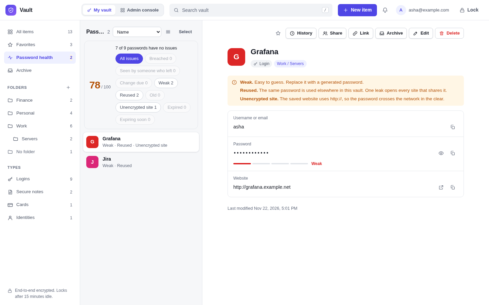
</details>

<details>
<summary><b>Import</b> — see what a file holds before anything is saved</summary>
<br>
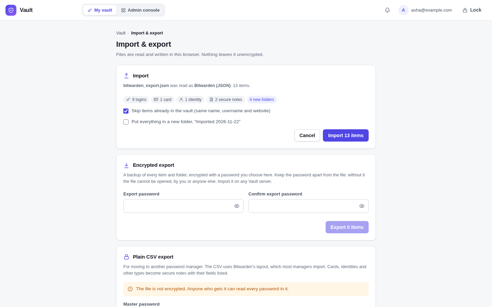
</details>

<details>
<summary><b>History</b> — every previous version, restorable</summary>
<br>
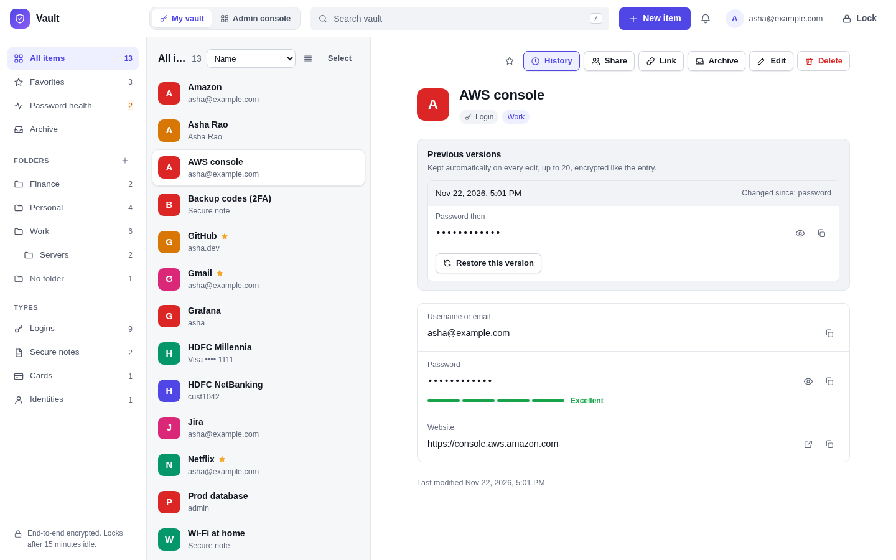
</details>

<details>
<summary><b>Cards and other item types</b></summary>
<br>
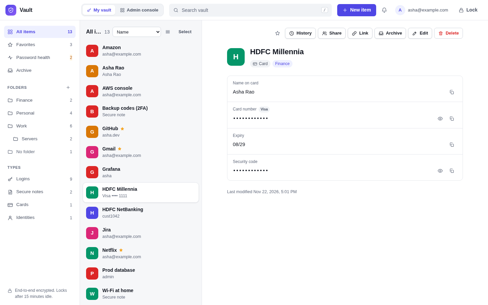
</details>

<details>
<summary><b>Devices and security activity</b></summary>
<br>
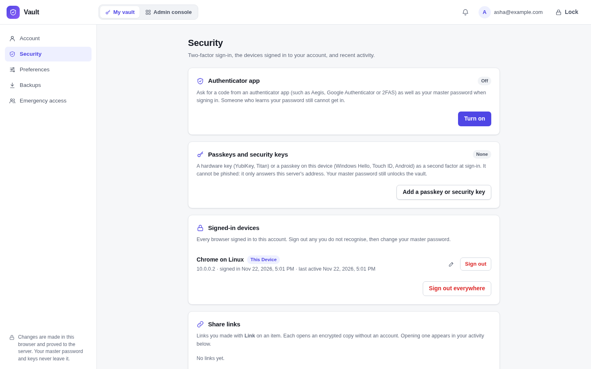
</details>

<details>
<summary><b>Dark mode and phones</b></summary>
<br>
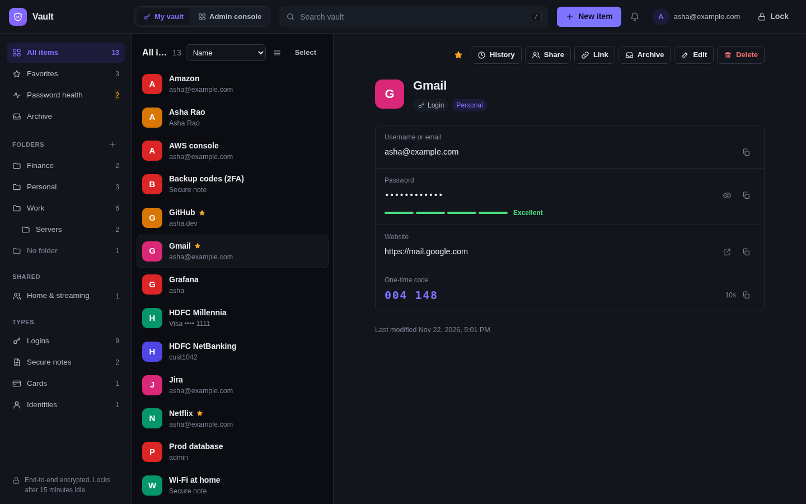
<p>
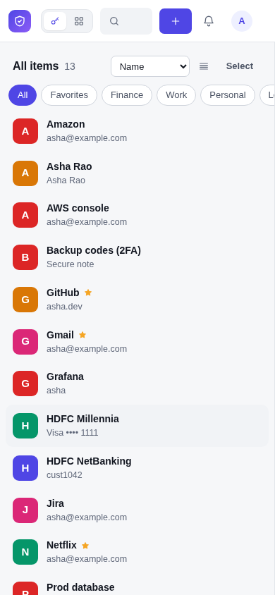
&nbsp;
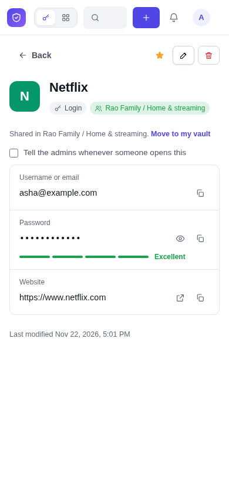
</p>
</details>

<details>
<summary><b>Organizations</b> — sharing, confirmed by fingerprint</summary>
<br>
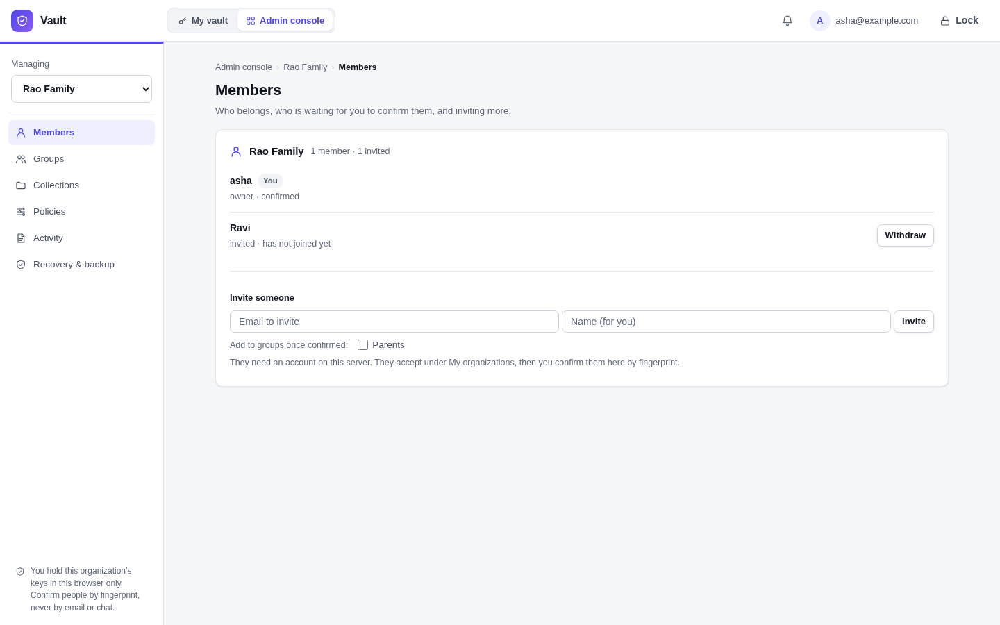
</details>

<details>
<summary><b>Service desk</b> — help and support, built in</summary>
<br>
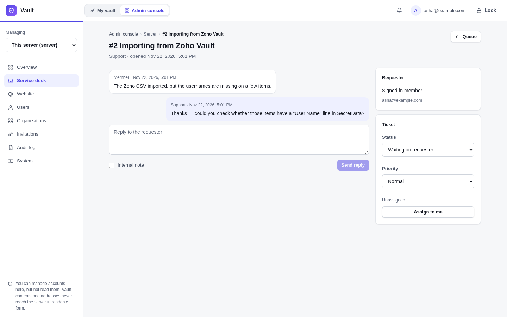
</details>

<details>
<summary><b>Website editor</b> in the admin console</summary>
<br>
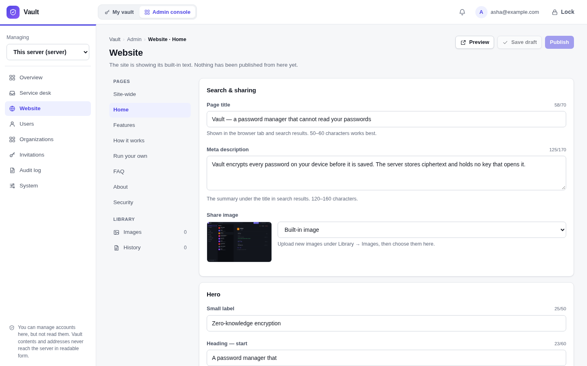
</details>

<details>
<summary><b>The public website</b></summary>
<br>
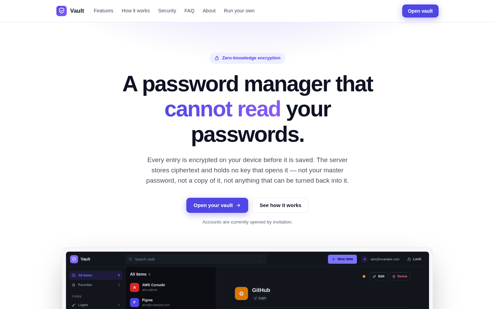
</details>

## How it works

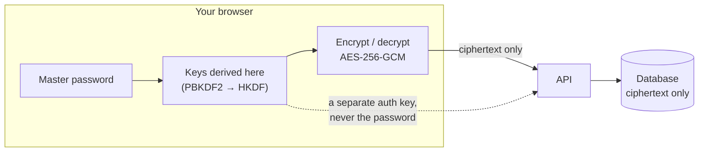

- The server receives an **auth key** derived through a separate, one-way branch. Seeing
  every one ever sent reveals nothing that decrypts a vault.
- A random **vault key** encrypts everything; the master password only wraps it, so changing
  the password is one write and nothing is re-encrypted.
- A **recovery key**, shown once at sign-up, is the only way back from a forgotten master
  password. There is no reset, because the server cannot perform one.

The full design: [ARCHITECTURE.md](ARCHITECTURE.md) and the
[decision records](decisions/). Adversaries and mitigations:
[threat model](docs/threat-model.md).

## Run it on your own server

One command on a Linux machine with Docker. It asks for the address, generates the secrets,
starts Vault and prints the link that creates your owner account. Run it again to upgrade.

```sh
curl -fsSL https://raw.githubusercontent.com/SHIVAM-SHARMA-766/vault/main/deploy/install.sh | sh
```

| | Personal | Business |
|---|---|---|
| For | You alone: one account, and you are its admin | A company: your people, groups and policies |
| Includes | The vault, extension, share links, backups, two-factor | All of that, plus invitations, organizations, collections, a service desk |
| Runs | Vault + SQLite + Caddy | Vault + PostgreSQL + Caddy |
| Hardware | 1 GB RAM, amd64 or arm64 | Your choice |

Two editions of one codebase ([decisions/0030](decisions/0030-editions.md)): each shows only what
its people need, and a personal Vault can become a business one later.

Everything is in the [install guide](docs/INSTALL.md): backups and restore, mail, upgrades,
verifying signed images, running behind your own proxy.

## Run it locally (development)

```sh
npm install
npm run build
npm run dev:stack      # the whole product on http://localhost:8080, in memory — no cloud account
```

<details>
<summary>Tests, screenshots and the API description</summary>

```sh
npm test               # crypto, core and API — 350 tests
npm run test:e2e       # 20 browser tests against the real stack (needs Chrome)
npm run screenshots    # regenerate docs/images from the running product
npm run openapi --workspace @vault/api   # regenerate docs/openapi.json
```

</details>

<details>
<summary>Repository layout</summary>

| Path | Contents |
|---|---|
| [`packages/crypto/`](packages/crypto/) | Every cryptographic operation. Zero dependencies |
| [`packages/core/`](packages/core/) | Item model, search, import/export, password health. Shared by every client, no UI |
| [`services/api/`](services/api/) | The API, its storage adapters, and its OpenAPI generator |
| [`apps/web/`](apps/web/) | The vault client and the admin console, at `/app/` |
| [`apps/site/`](apps/site/) | The public website: templates, editable content, renderer |
| [`apps/extension/`](apps/extension/) | The browser extension for Chrome and Firefox |
| [`services/`](services/) | Backup and restore drill, release pull agent, health probe |
| [`infra/`](infra/) | Terraform for everything the reference instance runs on |
| [`deploy/`](deploy/) | Install profiles: personal and business Compose files |
| [`scripts/`](scripts/) | Release, host setup, dev stack, screenshots |
| [`decisions/`](decisions/) | Why things are the way they are |
| [`docs/`](docs/) | User guide, runbook, configuration, threat model, roadmap |

</details>

## Documentation

| | Document | For |
|---|---|---|
| 📘 | [User guide](docs/USER-GUIDE.md) | Using Vault, screen by screen |
| 🏗️ | [Architecture](ARCHITECTURE.md) | How the system fits together, with diagrams |
| 🏠 | [Install guide](docs/INSTALL.md) | Running your own Vault: install, backups, mail, upgrades |
| ⚙️ | [Configuration](docs/configuration.md) | Every server setting |
| 🛡️ | [Security policy](SECURITY.md) | Reporting a vulnerability; verifying releases |
| 🔌 | [API](services/api/README.md) · [OpenAPI](docs/openapi.json) | Routes, errors, request ids |
| 🛠️ | [Runbook](docs/runbook.md) | Deploying, alerts, backups, restore drill, recovery |
| 🔒 | [Threat model](docs/threat-model.md) | Adversaries, mitigations, accepted risks |
| 🧭 | [Roadmap](docs/ROADMAP.md) | What is planned, what is done, what is left |
| 📋 | [Known issues](docs/KNOWN-ISSUES.md) | Current limits |
| 📰 | [Status](STATUS.md) | The running log of changes |
| 🧾 | [Decisions](decisions/) | The reasoning behind each design choice |

## Running cost

The reference instance runs on perpetual free allowances — $0 a month.

| Component | Service |
|---|---|
| Host | OCI compute `VM.Standard.E2.1.Micro`, always free |
| Database | OCI MySQL HeatWave `MySQL.Free`, 50 GB |
| Backups and releases | OCI Object Storage, two private buckets |
| Monitoring and alerts | OCI Monitoring and Notifications |
| TLS | Let's Encrypt, via Caddy |

<details>
<summary>Background: why this is a rewrite</summary>

An earlier version ran on a single VM with PostgreSQL. Its free allocation was withdrawn and
the instance reclaimed. Rather than rebuild it in place, Vault was rewritten from an empty
directory, because the old version transmitted the master password to the server and was
shaped for a host that no longer existed. None of the old code was carried over. The move
from AWS to OCI is explained in
[decisions/0003](decisions/0003-running-everything-on-oci.md).

</details>
