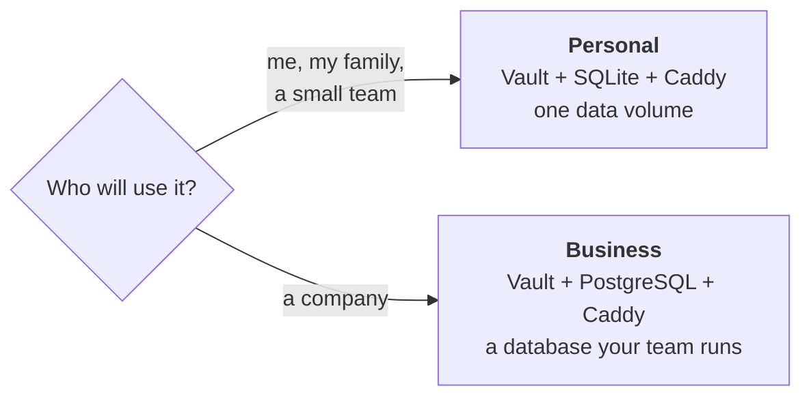
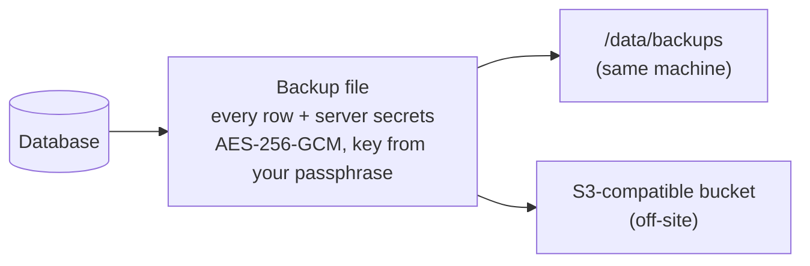

# Installing and running Vault

For whoever runs a Vault server: a person on a home server, or the IT team of a company. It
covers installing, the first account, configuration, backups and restore, mail, upgrades,
and keeping it healthy. Every setting is listed in [configuration.md](configuration.md).

<details>
<summary><b>Contents</b></summary>

- [Choose a profile](#choose-a-profile)
- [Requirements](#requirements)
- [Quick install](#quick-install)
- [Install: personal](#install-personal)
- [Install: business](#install-business)
- [The first account](#the-first-account)
- [Inviting people](#inviting-people)
- [Backups and restore](#backups-and-restore)
- [Mail](#mail)
- [Upgrading](#upgrading)
- [Verifying the image](#verifying-the-image)
- [Behind your own reverse proxy](#behind-your-own-reverse-proxy)
- [Running without containers](#running-without-containers)
- [Rotating secrets](#rotating-secrets)
- [Troubleshooting](#troubleshooting)

</details>

## Choose a profile



Both are the same Vault — every feature works in both. The difference is the database: a
single file (SQLite) that needs no administration, or PostgreSQL, which your team can back
up, monitor, replicate and put on separate storage. You can move from one to the other later
with a backup and a restore.

## Requirements

- A machine with Docker and Docker Compose v2: 1 GB RAM is enough; amd64 or arm64 (a
  Raspberry Pi 4 or 5 works).
- **HTTPS.** Browsers only allow the encryption Vault does in the page on a secure origin, so
  Vault does not work over plain `http://` (except on `localhost`). The profiles include
  Caddy, which gets a certificate automatically if:
  - a DNS name (e.g. `vault.example.com`) points at the machine, and
  - ports **80 and 443** reach it from the internet.
  For a server only reachable on your network, see
  [Behind your own reverse proxy](#behind-your-own-reverse-proxy).

## Quick install

On a Linux machine with Docker, one command asks for the address, writes the configuration
with fresh secrets, starts Vault, and prints the link that creates your owner account:

```sh
curl -fsSL https://raw.githubusercontent.com/SHIVAM-SHARMA-766/vault/main/deploy/install.sh | sh
```

It asks three things: **personal or business**, the **address** people will use (a DNS name
pointing at the machine, or `localhost` to try it out), and **where to install** (`/opt/vault`
as root, `~/vault` otherwise). It prints your backup passphrase once — store a copy away from
the machine. Read the script first if you prefer: it is short and commented.

Without questions (cloud-init, automation):

```sh
curl -fsSL https://raw.githubusercontent.com/SHIVAM-SHARMA-766/vault/main/deploy/install.sh \
  | VAULT_YES=1 VAULT_PROFILE=personal VAULT_HOSTNAME=vault.example.com sh
```

Running it again **upgrades**: it takes a backup of the running server, fetches the new
version, keeps your `.env`, and restarts. The manual steps below do the same by hand.

## Install: personal

```sh
git clone https://github.com/SHIVAM-SHARMA-766/vault.git && cd vault/deploy/personal
cp .env.example .env
#   VAULT_HOSTNAME=vault.example.com
#   BACKUP_PASSPHRASE=<16+ characters — keep a copy somewhere else>
docker compose up -d
```

The first start builds the image (a few minutes) unless `VAULT_IMAGE` names a published one.
Then open `https://vault.example.com` and continue with [the first account](#the-first-account).

Everything to keep is in the `vault-data` volume: the database, the server secrets, the
rendered website and local backups.

## Install: business

```sh
cd vault/deploy/business
cp .env.example .env
#   VAULT_HOSTNAME=vault.example.com
#   POSTGRES_PASSWORD=$(openssl rand -base64 24)
#   BACKUP_PASSPHRASE=...      and the BACKUP_S3_* settings for off-site copies
#   SMTP_HOST=... MAIL_FROM=...  to email invitations
docker compose up -d
```

To use a PostgreSQL you already run instead of the bundled one, remove the `postgres`
service and set `DB_HOST`, `DB_USER`, `DB_NAME`, `DB_PASSWORD` (and `DB_SSL=true` across a
network). Vault creates its table and runs migrations on start; give its user rights to
create tables in its database.

## The first account

A new server has no accounts and is closed to registration. It prints a one-time link to its
log:

```sh
docker compose logs vault | grep -A6 "First-run setup"
```

```
  ┌─ First-run setup ─────────────────────────────────────────────
  │ No accounts exist yet. Open this link to create the owner:
  │   https://vault.example.com/app/?setup=R27Z-VZYN-BXY9-91FT-GC52-XQWQ
  │ or choose "Create an account" and enter the code R27Z-VZYN-…
  │ It works once, for 7 days; a new one is printed on every start
  │ until it is used.
  └───────────────────────────────────────────────────────────────
```

Open it and create your account; it becomes the **owner**, with the admin panel. **Save the
recovery key it shows** — nobody, including you as the server's operator, can reset a
forgotten master password.

Then, in the admin panel's **Overview → Name and support**, give the server a name and a support
address. Both are shown on the sign-in screen and the help page, and the support address becomes
the Reply-To of every email Vault sends — so people who reply to an invitation or a sign-in
notice reach you, not the no-reply sender.

## Inviting people

The admin panel's Overview starts with **Finish setting up**: two-factor for you, a name and
support address, mail, a recent backup, registration not open, and your first invitations. Each
item ticks itself off.

Admin panel → **Invitations** → who it is for, how long it lasts, and the role they start
with. With [mail](#mail) set up, enter their address and they get the code and a link;
otherwise copy the code to them yourself. Registration stays closed to everyone else
(Overview → Registration: Closed / Invite only / Open).

**Many people at once:** Invitations → *Invite many people at once…*, then paste one person per
line (`email, name` — a spreadsheet column works). Everyone gets their own code by email, or,
without mail, the codes are listed once for you to send. Invitations only work while
registration is *Invite only* or *Open*; Vault warns if it is closed.

### Requests from people outside

The sign-in screen lets anyone ask for access, or for help when locked out of their
authenticator. Both land in the admin panel's **Service desk**. Approving an access request
issues an invitation in one click; resetting two-factor sign-in is for admins only, after you
have confirmed who is asking through another channel. Give someone the **Support** role to
work the queue without access to accounts.

## Backups and restore

**Turn backups on by setting `BACKUP_PASSPHRASE`** (16+ characters). Vault then writes one
encrypted backup a day to `/data/backups` (keeping 14), and to S3-compatible storage if the
`BACKUP_S3_*` settings are present — AWS S3, Cloudflare R2, Backblaze B2, OCI, Wasabi, MinIO.



- **A backup file plus the passphrase is a complete restore**, onto a new server, with either
  database. Keep the passphrase somewhere other than the server — a password manager that is
  not this one, or on paper.
- The vault contents inside are already encrypted by each user's keys; the passphrase also
  protects the server secrets and the structure of the data.
- For S3, create a key that can **only write objects in that bucket**, and set a lifecycle
  rule on the bucket to expire old backups.
- The admin panel's Overview shows when the last backup was taken.

Take one now:

```sh
docker compose exec vault node index.mjs backup
```

**Restore** (onto a new server, or to replace this one's data):

```sh
docker compose stop vault
chmod 644 vault-2026-11-07T03-00-00-000Z.vbk      # it is encrypted; the container's user must read it
docker compose cp ./vault-2026-11-07T03-00-00-000Z.vbk vault:/data/restore.vbk
docker compose run --rm -e BACKUP_PASSPHRASE='…' vault node index.mjs restore /data/restore.vbk
#   add --force to replace a database that is not empty
docker compose start vault
```

The restore writes the backup's server secrets into `/data/secrets.env` (keeping the old file
beside it), so restored accounts sign in as before. Practise it once — a backup nobody has
restored is not a backup.

## Mail

Set `SMTP_HOST`, `SMTP_PORT` (587 or 465), `SMTP_USER`, `SMTP_PASSWORD` and `MAIL_FROM`. Vault
then emails invitations, sends a notice on each sign-in (and always when a recovery key is
used), and the admin panel's Overview has **Send test**. Plain-text SMTP is refused.

Vault does not store email addresses — only keyed digests — so it mails someone only when a
request carries their address, and does not keep it.

## Upgrading

Run the installer again (it backs up first), or by hand:

```sh
cd vault && git pull            # or change VAULT_IMAGE to the new version
cd deploy/personal              # or business
docker compose exec vault node index.mjs backup     # first, always
docker compose up -d --build
docker compose logs vault | grep "schema version"
```

On start, Vault migrates its database to the new schema, under a lock, and records the
version. A server **refuses to start against a database a newer release has already
upgraded**, so an accidental downgrade stops instead of damaging data — restore the backup
you took first if you need to go back. CI tests every upgrade from the previous release's
image on the same data.

## Verifying the image

Released images are published by the repository's release workflow and signed with Sigstore
using that workflow's identity — there is no signing key to steal. Each carries an SBOM and
build provenance.

```sh
cosign verify ghcr.io/shivam-sharma-766/vault:1.0.0 \
  --certificate-identity-regexp 'https://github.com/SHIVAM-SHARMA-766/vault/.github/workflows/image.yml@refs/tags/v.*' \
  --certificate-oidc-issuer https://token.actions.githubusercontent.com
docker buildx imagetools inspect ghcr.io/shivam-sharma-766/vault:1.0.0 --format '{{ json .SBOM }}'
```

## Behind your own reverse proxy

If you already run nginx, Traefik or another proxy with TLS, skip Caddy: run only the
`vault` service, forward all paths to it on port 8080, and pass `X-Forwarded-For`. Vault sets
its own security headers. If clients can reach port 8080 directly, set `TRUST_PROXY=false`.

For a server only on your network, give the proxy a certificate your devices trust (your own
CA, or Caddy's `tls internal` with its root installed on each device).

## Running without containers

Node.js 20 or newer, then from a release build:

```sh
npm ci && npm run build && npm run bundle --workspace @vault/api
cd services/api/dist-bundle && npm install better-sqlite3@11.7.0   # only for SQLite
VAULT_HOSTNAME=vault.example.com SERVE_STATIC=true DB_DRIVER=sqlite DB_PATH=/var/lib/vault/vault.db \
  SECRETS_FILE=/var/lib/vault/secrets.env WEB_ROOT=../../../apps/web/dist SITE_SOURCE=../../../apps/site \
  node index.mjs
```

Run it under systemd with a dedicated user; `services/api/vault-api.service` is the reference
instance's unit, hardened, and a good starting point.

## Rotating secrets

| Secret | How | Effect |
|---|---|---|
| `TOKEN_SIGNING_KEY` | Replace it in `/data/secrets.env`, restart | Everyone is signed out; nothing else changes |
| `BACKUP_PASSPHRASE` | Change it, restart | New backups use the new one; **old backups still need the old one** — keep it until they expire |
| `SERVER_PEPPER` | **Do not change it.** | It keys every address digest: changing it locks every account out |
| Database password | Change it in the database and in `.env`, restart | — |

## Troubleshooting

| Symptom | Look at |
|---|---|
| The page is blank, or "crypto.subtle is undefined" | You are on `http://`. Vault needs HTTPS |
| Caddy cannot get a certificate | DNS points elsewhere, or ports 80/443 are blocked: `docker compose logs caddy` |
| `failed to start: configuration:` | The listed settings — every problem is printed at once |
| `the database is at schema version N, newer than this server` | You started an older release on upgraded data; start the newer one |
| No setup link in the log | An account already exists, or `ADMIN_EMAILS` names the owner |
| `backup FAILED:` in the log | The message says why: passphrase, disk space, or S3 permissions |
| An error in the app shows `(reference abcd1234)` | `docker compose logs vault \| grep abcd1234` finds that request |
| Health | `docker compose ps` shows the container's health check; `/api/health` answers `{"status":"ok"}` |
