# Roadmap

Where Vault is going, in what order, what is finished and what is left. Written for the
people building it and for an AI assistant picking up the work cold, so it says why as well
as what.

| Document | Role |
|---|---|
| **This page** | The plan, and progress against it |
| [STATUS.md](../STATUS.md) | The running log: what changed, when, and what it took |
| [KNOWN-ISSUES.md](KNOWN-ISSUES.md) | Limits and accepted risks of what exists today |
| [`decisions/`](../decisions/) | Why things are the way they are |

Last revised: 2026-11-07 (phase 2 built)

## At a glance

```mermaid
flowchart LR
  p0["Phase 0<br/>Foundation<br/>✅ done"]:::done --> p1["Phase 1<br/>Complete personal vault<br/>✅ closed · domain deferred"]:::done
  p1 --> p2["Phase 2<br/>Self-hosted product<br/>✅ built · 3 decisions open"]:::done
  p2 --> p3["Phase 3<br/>Service desk · teams<br/>✅ built"]:::done
  p3 --> p35["Phase 3.5<br/>Improvement pass<br/>⬜ next"]:::next
  p35 --> p4["Phase 4<br/>Browser extension"]:::later
  p4 --> p5["Phase 5<br/>Android"]:::later
  p5 --> p6["Phase 6<br/>Enterprise"]:::later
  classDef done fill:#dcfce7,stroke:#16a34a,color:#14532d
  classDef now fill:#fef9c3,stroke:#ca8a04,color:#713f12
  classDef next fill:#e0e7ff,stroke:#4f46e5,color:#1e1b4b
  classDef later fill:#f3f4f6,stroke:#9ca3af,color:#374151
```



| Phase | Goal | State |
|---|---|---|
| 0 — Foundation | Keys for sharing, local stack, browser tests, release pipeline | ✅ Done 2026-11-06 |
| 1 — Complete personal vault | Everything one person needs, hardened and monitored | ✅ Closed 2026-11-07; domain deferred, operator steps carried |
| 2 — Self-hosted product | Anyone installs and upgrades it with one command | ✅ All 8 steps built 2026-11-07; licence, pricing and update channel still to decide |
| 3 — Service desk, then teams | Help and support built in; then organizations, shared collections, policies | ✅ Built 2026-11-07 |
| 3.5 — Improvement pass | Harden, polish and speed up everything built so far, before a second client | ⬜ Next |
| 4 — Browser extension | Autofill, the main way a password manager is used | ⬜ Planned |
| 5 — Android | Autofill and biometric unlock on the phone | ⬜ Planned |
| 6 — Enterprise | SSO, SCIM, HA | ⬜ Planned |

## The target

**A zero-knowledge password manager that anyone runs on their own server** — one person on a
home server, a family, or a company with hundreds of people
([0010](../decisions/0010-self-hosted-product.md)). It does the job Zoho Vault, 1Password and
Bitwarden do, for personal and business use alike, delivered the way Bitwarden's self-hosted
edition is: a signed package the
customer installs and upgrades, with no central service and nothing phoning home. Two things
are not negotiable: the server never holds anything readable, including who you are
(addresses are keyed hashes) and what you store (names, URLs and tags are encrypted too); and
the customer never depends on us to keep running.

This project's own deployment on OCI is the reference instance and demo, run with the same
package customers get.

**One product, every size.** Personal and business are not separate editions: the same
package runs a single person's vault on a Raspberry Pi and a company's on a cluster. Every
member of a team keeps their own private vault, a single person never has to create an
organization, and features scale up rather than branch.

The first client after the web app is a **browser extension**, because that is where a
password manager is actually used — and because code installed from a package is not served
by the hostname, which closes the largest accepted risk (threat A3) for everyone who uses it.

## Where it stands

| Area | Today |
|---|---|
| Distribution | A container image and two Compose profiles anyone can install ([INSTALL.md](INSTALL.md)); signed releases on tag |
| Cryptography | PBKDF2 → HKDF key hierarchy, random vault key, recovery key, AES-256-GCM everywhere, identity key pairs (P-256), encrypted export format ([0001](../decisions/0001-cryptography-and-key-hierarchy.md), [0009](../decisions/0009-identity-keys-and-sharing.md)) |
| Vault | Seven entry types with their own fields, nested folders, custom fields, password history with restore, search, favourites, TOTP codes, generator, clipboard clearing, auto-lock, password health, import from nine formats, encrypted and CSV export |
| Account | Change master password, recovery key sign-in and rotation, TOTP two-factor with recovery codes, signed-in devices, security activity |
| Administration | Roles (owner, admin, marketing, viewer), invitations, account management, audit log, website editor ([0006](../decisions/0006-admin-panel.md), [0007](../decisions/0007-roles-and-site-editing.md)) |
| API | Typed error codes, request ids, generated OpenAPI document, one configuration module |
| Delivery | Merge to `main` → CI publishes → host pulls, verifies, rolls back ([0005](../decisions/0005-pull-based-releases.md), [0008](../decisions/0008-release-pipeline.md)) |
| Operations | Health probe and eight OCI alarms, daily verified export, scripted restore drill |
| Quality | 327 unit and API tests, 16 browser tests, CI on every change incl. the container, an install profile, backup/restore and upgrades |
| Infrastructure | One always-free OCI instance, MySQL HeatWave (always free), $0 a month |

## How it compares

What a team buyer expects, against what exists. ✓ built · ◐ partly · — not yet. The phase is
where it lands.

| Capability | Zoho Vault | 1Password | Vault | Phase |
|---|---|---|---|---|
| Customer runs it on their own servers | — | — | ◐ one hand-built instance | 2 |
| Signed releases, SBOM, safe upgrades | n/a | n/a | — | 2 |
| Zero-knowledge encryption of passwords | ✓ | ✓ | ✓ | — |
| Names, URLs, tags encrypted too | ◐ | ✓ | ✓ | — |
| Recovery without the server | ◐ | ✓ (Emergency Kit) | ✓ (recovery key) | — |
| Change master password / recovery login in the UI | ✓ | ✓ | ✓ | 1 |
| Folders, password history, custom fields in the UI | ✓ | ✓ | ✓ | 1 |
| Import from other managers, export | ✓ | ✓ | ✓ | 1 |
| Password health (weak, reused, old) | ✓ | ✓ (Watchtower) | ✓ | 1 |
| Breach check without revealing passwords | ◐ | ✓ | — | 1 (decision needed) |
| Two-factor sign-in for the account | ✓ | ✓ | ✓ TOTP | 1 |
| Device and session management | ✓ | ✓ | ✓ | 1 |
| Secret key mixed into the KDF | — | ✓ | — | 1 (decision needed) |
| Organizations, teams, shared collections | ✓ | ✓ | ✓ | 3 |
| Per-collection permissions, hide-password | ✓ | ✓ | ✓ | 3 |
| Organization policies (password strength, 2FA required) | ✓ | ✓ | ✓ | 3 |
| Per-item access audit | ✓ | ✓ | ✓ | 3 |
| Emergency / break-glass access | ✓ | ✓ | ✓ | 3 |
| Browser extension with autofill | ✓ | ✓ | — | 4 |
| Passkeys | ◐ | ✓ | — | 4–5 |
| Mobile apps with autofill and biometrics | ✓ | ✓ | — | 5 |
| Offline access | ✓ | ✓ | — | 4–5 |
| SSO (OIDC/SAML), SCIM provisioning | ✓ | ✓ | — | 6 |
| CLI and secrets for developers | ◐ | ✓ | — | 6 |

## Principles every phase keeps

1. **Nothing readable on the server.** A feature that needs the server to see content is
   redesigned or not built. Every feature names, in its decision record, what the server
   learns.
2. **No third parties in the trust path.** No analytics, CDNs, fonts, icon services, or
   external APIs from the client. Where an outside service is unavoidable (breach checks), it
   gets a decision record and a privacy-preserving protocol.
3. **Every new trust boundary enters the threat model** before the feature ships.
4. **Every user-facing flow has a browser test** in `tests/e2e`, and every API route has
   tests for who may and may not call it.
5. **One release path.** Merge to `main`. No hand deploys of code.
6. **Deployment is configuration.** Nothing in the product names a host, provider, region or
   address; this project's own instance is configured like any customer's.
7. **The customer never depends on us at run time.** No telemetry, no licence server, no
   update check they cannot turn off.
8. **$0 for this project's own infrastructure** (the reference instance and the pipeline);
   customers choose and pay for theirs.

## Phases

Each phase has exit criteria. A phase is done when all of them hold, not when its list is
empty.

### Phase 0 — Foundation ✅ (2026-11-06)

- [x] Identity key pairs on every account; the sharing model designed ([0009](../decisions/0009-identity-keys-and-sharing.md))
- [x] One-command local stack (`npm run dev:stack`) and browser tests in CI
- [x] `prevent_destroy` on the database; CI green on a clean checkout
- [x] Release pipeline live (merge → publish → host pulls)

### Phase 1 — A complete, hardened personal vault ✅ (closed 2026-11-07)

Closed by the operator with the domain deferred. The open operator items below carry
forward and do not block phase 2.

The core every later phase builds on must be finished and trustworthy first.

**Product** — all done

| | Item | Where to see it |
|---|---|---|
| ✅ | Account settings: change master password, rotate recovery key, recovery-key sign-in, identity fingerprint | Settings — [guide](USER-GUIDE.md#account-settings) |
| ✅ | Two-factor sign-in (TOTP) with recovery codes, enforced by the server | Settings → Two-factor |
| ✅ | Signed-in devices: list, name, sign out; security activity | Settings — [guide](USER-GUIDE.md#devices-and-activity) |
| ✅ | Nested folders, every type's own fields, custom fields, password history with restore | Vault — [guide](USER-GUIDE.md#folders-and-history) |
| ✅ | Import (Chrome/Edge/Brave, Firefox, Safari, Bitwarden JSON+CSV, 1Password, LastPass, KeePass, Zoho Vault, any named-column CSV) and export (encrypted, plain CSV behind the master password) | Import & export — [guide](USER-GUIDE.md#import-and-export) |
| ✅ | Password health: weak, reused, old, unencrypted site | Vault → Password health — [guide](USER-GUIDE.md#password-health) |
| ⬜ | WebAuthn / security key as a second factor | Not started; proposed to land with passkeys in phase 4 |

**Platform** — all done

- [x] Client architecture: router, feature modules, shared UI kit
- [x] `packages/core`: item model, search, import/export parsers, password health — no React
- [x] API: request ids in logs, typed error codes, OpenAPI generated from the routes

**Self-host prerequisites** — all done

- [x] One configuration module, no installation-specific defaults ([configuration.md](configuration.md))
- [x] Storage stays behind its interface, enforced by a test

**Operations**

- [x] Monitoring and alerting on the free tier: health probe, eight alarms incl. a heartbeat ([runbook](runbook.md#alerts))
- [x] Restore drill, scripted, with a reminder alarm ([runbook](runbook.md#the-quarterly-restore-drill))
- [ ] **Operator:** `apply.sh`, confirm the alert mail, `deploy.sh`, run the first drill
- [ ] **Operator:** buy a domain and move the reference instance to it (threat A3) — *deferred 2026-11-07*

**Exit criteria**

| Criterion | State |
|---|---|
| Every API capability has a UI | ✅ |
| 2FA works end to end | ✅ browser-tested |
| Import from three managers tested with **real** export files | ⬜ tested with fixtures in each published format; real files still needed |
| Alerts reach a phone | ⬜ built; needs the operator steps above |
| The domain is live | ⏸ deferred by the operator (2026-11-07) |

**Decisions this phase still owes** — see [Open decisions](#open-decisions): secret key in the
KDF, breach checks, Argon2id.

### Phase 2 — The self-hosted product ✅ (built 2026-11-07)

What a customer installs. Built before teams because packaging, configuration and upgrades
touch every part of the system, and are cheaper to get right while it is small.

**Steps, in order**

| # | Step | State |
|---|---|---|
| 1 | Storage: SQLite and PostgreSQL beside MySQL, one contract suite, versioned migrations ([0012](../decisions/0012-storage-drivers-and-migrations.md)) | ✅ |
| 2 | One server process serves the client, the site and the API, with the Caddyfile's headers | ✅ |
| 3 | Container image: non-root, `/data` volume, health check, secrets generated on first start | ✅ |
| 4 | First-run setup: a one-time link in the log creates the owner | ✅ |
| 5 | Install profiles: personal (SQLite + Caddy) and business (PostgreSQL + Caddy); [INSTALL.md](INSTALL.md) | ✅ |
| 6 | Backups: encrypted, to disk and any S3-compatible store; restore onto any driver, tested in CI | ✅ |
| 7 | Mail: the customer's SMTP for invitations and sign-in / recovery notices | ✅ |
| 8 | Supply chain and upgrades: multi-arch signed images with SBOM and provenance, [SECURITY.md](../SECURITY.md), upgrades tested | ✅ |

All decided in [0013](../decisions/0013-distribution-and-releases.md). **Left for the operator:**
choose the update channel, licence and pricing; tag the first release (`git tag v1.0.0`),
which runs the image workflow.

**Scope**

- [x] **Two install profiles from one image**:
  - *Personal*: one container with SQLite and built-in TLS — small enough for a Raspberry Pi
    or a free cloud VM, started with one command.
  - *Business*: Compose with PostgreSQL and a reverse proxy, documented for HA in phase 6.
  - A tarball with systemd units as the alternative to containers.
- [x] **First-run setup**: a one-time token in the server log lets the first visitor create the
  owner. Replaces `ALLOW_REGISTRATION` and `ADMIN_EMAILS` for customers.
- [x] **Storage**: PostgreSQL alongside MySQL; SQLite for a single server. One store contract test
  suite that every adapter passes.
- [x] **Schema migrations**: versioned, run on start, tested from every supported version.
- [x] **Backups**: scheduled encrypted exports to local disk or any S3-compatible store; restore
  documented and tested.
- [x] **Mail**: the customer's SMTP for invitations and security notices.
- [x] **Supply chain**: signed images and tarballs (signing key held outside CI in plain form),
  SBOM, reproducible builds, a security policy and disclosure address.
- [x] **Admin documentation**: install, configure, upgrade, back up, restore, rotate secrets.
- [ ] **Licensing**, once decided: verified offline, never a run-time dependency.

**Exit criteria**

| Criterion | State |
|---|---|
| Personal profile runs on a 1 GB ARM board with one command | ◐ the image is built for arm64 and runs in 218 MB; not yet tried on a real board |
| Fresh VM to a business install with TLS in under 15 minutes, following the docs | ◐ the profile comes up on TLS in CI and locally in minutes; needs a real domain to time end to end |
| Upgrades across releases without manual steps | ✅ every earlier schema migrates; CI upgrades the previous image's volume |
| Restore from backup tested in CI | ✅ in the image job, into a fresh container |
| A tampered image is refused | ◐ images are signed and `cosign verify` refuses a tampered one; verifying is the customer's step |

### Phase 3 — Service desk, then teams ✅ (built 2026-11-07)

**Part A — Service desk (ITSM) ✅ built 2026-11-07** ([0014](../decisions/0014-service-desk.md)). Requested by the operator on 2026-11-07: the
product needs its own help and support, so access requests, sign-in problems and questions
do not depend on email threads or chat outside it. Built before teams because teams will
generate exactly these requests, and because a company evaluating Vault expects it.

- [x] Public requests from the sign-in screen, no account needed: **request access** (when
  registration is not open) and **can't sign in / lost my authenticator**. Rate-limited, and
  the answer never reveals whether an address has an account (threat A7).
- [x] **Help & support** for signed-in users: tickets with a category, a conversation, status
  (open → in progress → waiting → resolved → closed), and optional email updates.
- [x] **Service desk** in the admin panel: a queue with filters, assignment, priority, replies
  and staff-only notes; one-click actions — approve an access request (creates and emails an
  invitation), reset two-factor sign-in for a locked-out account after verifying the person.
- [x] A **support** role: works the queue and issues invitations, nothing else.
- [x] Privacy: ticket text is readable by staff (it is not vault data, and the UI says never
  to put a password in it); a requester's email address is kept only while the ticket is
  open and erased when it closes; resolved tickets close themselves after seven days.

**Part B — Teams** ([0015](../decisions/0015-organizations-and-collections.md)).

| # | Step | State |
|---|---|---|
| 1 | Organizations: create, invite by address, accept, **confirm by fingerprint**, remove | ✅ 2026-11-07 |
| 2 | Collections: create, seal the key to members, move items in and out, shared items in the vault | ✅ 2026-11-07 |
| 3 | Permissions per collection: view, edit, manage; hide passwords as a labelled policy | ✅ 2026-11-07 |
| 4 | Removal rotates collection keys and re-encrypts | ✅ 2026-11-07 |
| 5 | Groups, so collections are granted to teams | ✅ 2026-11-07 |
| 6 | Organization policies: 2FA required, master password strength, session length | ✅ 2026-11-07 |
| 7 | Access audit: who opened, copied, edited or shared which item | ✅ 2026-11-07 |
| 8 | Emergency access ✅; organization recovery — not built, an open decision for 3.5 ([0016](../decisions/0016-teams-completion.md)) | ✅ 2026-11-07 |
| 9 | Organization administration grows in the admin panel; operator roles stay for running the service | ✅ 2026-11-07 |

**Exit criteria:** two people in an organization share a collection, one is removed and cannot
read anything added after; every step has browser tests with two browsers; threat A11 is
mitigated by the confirmation step.

### Phase 3.5 — Improvement pass

Requested by the operator on 2026-11-07: once teams are done and before the extension, a
phase that adds no new surface and makes everything existing better. A second client
multiplies the cost of every rough edge, so they are paid down first.

- [ ] Organization recovery: decide whether to offer it at all ([0016](../decisions/0016-teams-completion.md)).
- [x] Independent security review of everything since phase 1: one critical (cross-organization
  item access) and five medium/low findings fixed with regression tests; one design gap
  recorded as threat A15 (signed key grants).
- [ ] Decide the crypto questions: signed key grants (A15), secret key in the KDF, breach checks,
  Argon2id.
- [x] Performance: 5,000-item vault unlocks in **1.1 s** at 4× CPU throttle (was 4.2 s) — imported
  keys cached (dropped on wipe), long lists drawn incrementally; first load 111 → 77 KB gzipped.
  `node scripts/bench.mjs`. Backup streaming not needed at intended sizes.
- [x] Accessibility: every screen passes axe-core WCAG 2.1 AA in light and dark (contrast fixed),
  checked in CI.
- [x] Error messages, empty states and onboarding reviewed end to end (E0, E3, E8 below).
- [ ] Test gaps: ~~a live SMTP test~~ (done: STARTTLS delivery and plain-text refusal, in CI); real export files for import, an ARM board, a timed install — need the operator.
- [ ] Documentation and screenshots refreshed.

**Exit criteria:** no open 🔴 item in KNOWN-ISSUES without a recorded decision; every screen
passes an accessibility check; the 5,000-item vault unlocks in under two seconds on a phone.

#### Product backlog from the Zoho Vault / 1Password comparison (2026-11-07)

The operator asked for everything below to be built one by one, each reviewed and tested. IDs
are stable so work can be referred to by number. ✅ done · ⬜ open.

**A. Handing Vault to one person**
- ✅ A1 One-line installer: asks profile and address, writes `.env` with fresh secrets (mode 600), backs up before an upgrade, prints the setup link; CI installs through it
- ⬜ A2 First-run wizard in the browser (mail, backups, registration, support contact)
- ✅ A3 Server name and support contact set in the admin panel; shown on sign-in and help; Reply-To of every email
- ⬜ A4 "Get Vault" page on the site
- ✅ A5 Update checker in the admin panel (every 12 h from the server, `UPDATE_CHECK=false` turns it off)
- ⬜ A6 No-domain mode (DuckDNS / Cloudflare Tunnel guide)

**B. An organization on its own server**
- ⬜ B1 Setup checklist in the admin panel · ⬜ B2 Bulk invite (CSV, group on invite, resend) · ⬜ B3 Branding (logo, colours)
- ⬜ B4 Member onboarding · ⬜ B5 Helm chart and reverse-proxy guides · ⬜ B6 Metrics endpoint and dashboard
- ⬜ B7 Audit export and SIEM stream · ⬜ B8 SSO (OIDC) · ⬜ B9 Offboarding with automatic rotation

**C. Backups, per user (like Zoho)**
- ✅ C1 Schedule, time and retention in Settings · ✅ C2 Destinations: on the server (download), S3-compatible, WebDAV — email left out, see [0017](../decisions/0017-personal-backups.md)
- ⬜ C3 Google Drive / OneDrive · ⬜ C4 Encrypted offline copy that opens without the server
- ✅ C5 Backup history, test restore, and restore through Import & export · ⬜ C6 Organization backups · ⬜ C7 Server backup settings in the admin UI

**D. Features others have**
- ⬜ D1 More item types · ⬜ D2 File attachments · ⬜ D3 Secure share links · ✅ D4 Archive
- ⬜ D5 Breach check and a Watchtower-style dashboard · ⬜ D6 Expiry and rotation reminders · ⬜ D7 Access requests (check-out)
- ✅ D8 Passphrase generator (EFF large list, defaults in Preferences) · ⬜ D9 Passkeys and security keys · ⬜ D10 The crypto decisions above
- ⬜ D11 Share one item with one person · ⬜ D12 Notify on access to a sensitive item

**E. UI/UX**
- ✅ E0 Screen-by-screen audit (first pass: phone layout bug, registration-aware sign-in, org page order) · ✅ E1 Settings in sections (Account, Security, Preferences, Emergency) · ✅ E2 Theme switch
- ✅ E3 Getting-started checklist beside a new vault · ⬜ E4 Command palette and shortcuts · ⬜ E5 Bulk actions · ⬜ E6 Richer list views
- ⬜ E7 Phone layout pass · ✅ E8 Plain-language errors with a next step · ⬜ E9 Languages · ⬜ E10 Notification centre

**F. Personal settings**
- ✅ F1 Auto-lock time and lock-on-hide · ✅ F2 Clipboard clearing · ✅ F3 Generator defaults
- ⬜ F4 Reveal and count options · ⬜ F5 Email alerts · ⬜ F6 Default folder · ⬜ F7 Date, time and language · ✅ F8 Delete my account

**G. Administrator settings**
- ⬜ G1 Session policy · ⬜ G2 IP allow-list · ⬜ G3 Password policy · ⬜ G4 Sharing policy
- ⬜ G5 Rate limits in the UI · ⬜ G6 Editable email templates · ⬜ G7 Data retention

### Phase 4 — Browser extension

- [ ] Manifest V3, Chrome and Firefox from one codebase, built from `packages/core` and the
  crypto package.
- [ ] **Points at the customer's server**: the server URL is chosen at first run, and the
  extension's permissions are limited to that origin for API calls.
- [ ] Autofill matched by exact origin and registrable domain (public suffix list bundled, not
  fetched); never fills into a mismatched or cross-origin frame.
- [ ] Save and update on form submit; generator in the page; TOTP fill.
- [ ] Unlock with the master password; keys held in memory with the same idle rules as the web
  client; the extension's own Content-Security-Policy.
- [ ] Talks to the API directly; no page script is ever given the vault key.
- [ ] Passkey storage and use, after autofill is solid.

**Exit criteria:** fills and saves on the top sites in a test matrix; a phishing page on a
look-alike domain gets nothing; published to the Chrome Web Store and Firefox Add-ons.

### Phase 5 — Mobile

Android first (Kotlin), configured with the customer's server URL, using the Android autofill framework; biometric unlock with the vault
key wrapped by a hardware-backed keystore key; an encrypted offline cache. iOS when there is
a reason and a Mac to build on.

**Exit criteria:** cross-implementation crypto tests pass between Android and the web
(including the `pk1` format); autofill works in the top apps in a test matrix.

### Phase 6 — Enterprise

SSO against the customer's identity provider (OIDC first, then SAML) with trusted-device key
handling; SCIM provisioning from their directory; a CLI with secrets injection for developers;
a high-availability reference architecture (several app instances, a replicated database) and
a Helm chart; documented controls customers need for their own audits (access reviews, change
management, incident response).

## Architecture direction

```
packages/crypto   primitives, key hierarchy, identity keys      (no dependencies, ever)
packages/core     item model, search, import/export, health     (no UI)
services/api      HTTP API over one table; storage behind an interface
apps/web          the web client and admin                      (feature modules)
apps/extension    MV3 extension                                 (phase 4)
apps/site         public website, templates + content
android/          Kotlin client                                 (phase 5)
```

Data stays in one table with a partition per owner. Phase 3 adds partitions for organizations
(`ORG#<id>`) holding collections, memberships and sealed collection keys, so an organization's
data is one query, as a user's is today ([0002](../decisions/0002-storage-and-data-model.md)).

The API stays one process behind Caddy until load says otherwise. When a second client
exists, routes move under `/api/v1/` and the old paths remain until the web client has moved.

## Infrastructure: the reference instance, on $0

This section is about this project's own instance and pipeline. Customers size their own.

| Limit | Value | When it bites |
|---|---|---|
| Host | 1/8 OCPU-equivalent, 1 GB RAM (`E2.1.Micro`) | Hundreds of concurrent users, or PBKDF2-heavy endpoints under attack |
| Database | `MySQL.Free`: 50 GB, no managed backups, no HA | Data size is not the issue; recovery time and the lack of point-in-time restore are |
| Object Storage | 20 GB, 50,000 requests a month, shared by backups and releases | More frequent backups or releases than about one every few minutes |
| Availability | One host, one region, idle reclamation possible | Any customer with an uptime requirement |

The reference instance stays on the free tier; a customer's install is sized by the customer,
with guidance in the admin documentation.

## Open decisions

| Decision | Phase | Notes |
|---|---|---|
| Buy a domain | — | Deferred by the operator (2026-11-07). Removes the dynamic-DNS risk (A3); accepted until then |
| Secret key in the KDF | 1 | Strongest protection against offline guessing after a breach |
| Breach checks | 1 | Privacy trade-off; k-anonymity at best |
| Argon2id | 1 | Needs WebAssembly in the crypto package |
| Licence | 2 → before the first public release | Open source (AGPL, as Bitwarden), source-available, or proprietary with offline keys |
| Pricing | 2 | Per user, per server, or support contracts |
| Update channel | 2 → before the first public release | The workflow pushes to GHCR, private while the repo is. Public registry, or authenticated |
| ~~Supported databases~~ | 2 | Decided: SQLite, PostgreSQL and MySQL 8 ([0012](../decisions/0012-storage-drivers-and-migrations.md)) |
| Organization recovery | 3.5 | Not built ([0016](../decisions/0016-teams-completion.md)). Opt-in, visible to members, or not offered |
| iOS | 5 | Needs Apple hardware and an account |

## Risks

- **One operator.** Bus factor of one for code, infrastructure and keys. Mitigated by
  documentation written for someone arriving cold, and by recovery that never depends on the
  operator for a user's data.
- **Our release is every customer's trust path.** One compromised build reaches every install.
  Signing, SBOMs and reproducible builds (phase 2) are the answer; until then, `main` and the
  release pipeline are protected by 2FA on the accounts that control them.
- **Browser-delivered code (A3).** On a customer's install their own domain is the trust path;
  on the reference instance it is still DuckDNS until the domain is bought.
- **Self-hosted support load.** Every customer environment differs. A narrow supported path
  (the Compose install) and good diagnostics keep it tractable.
- **Always-free reclamation.** An idle instance can be reclaimed. The data survives in the
  database and exports; the service does not. See the runbook.
- **Cryptographic format is permanent.** Every new ciphertext format is versioned and gets a
  decision record before anything is written in it.
