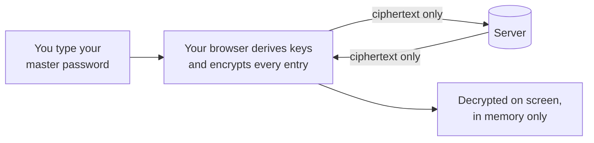
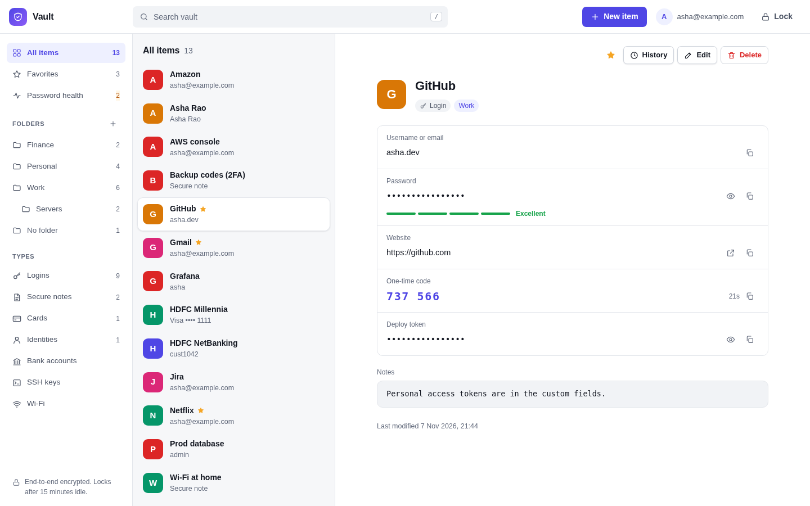
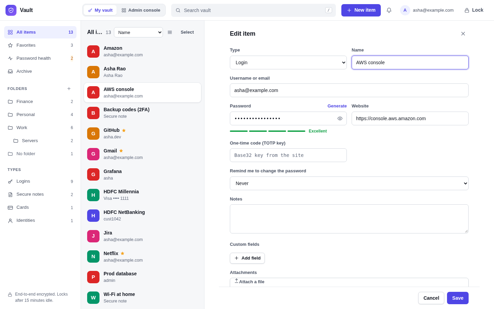
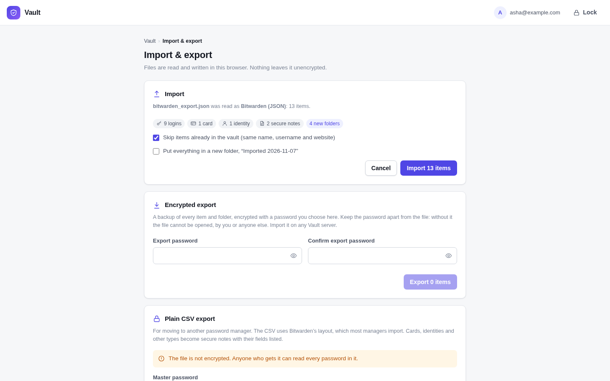
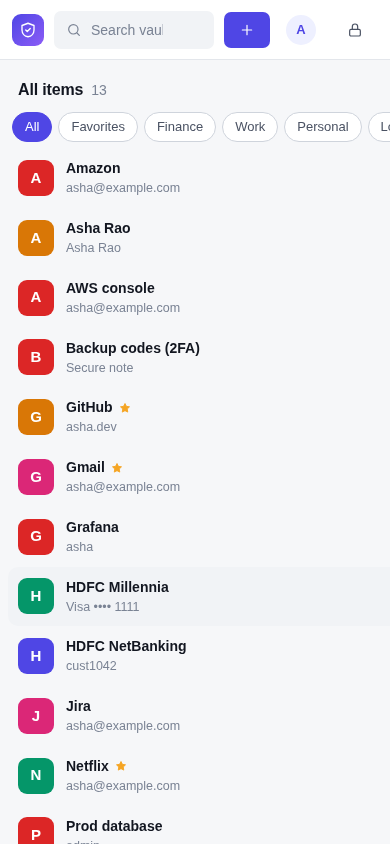
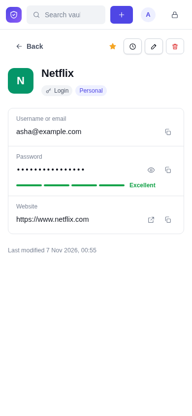
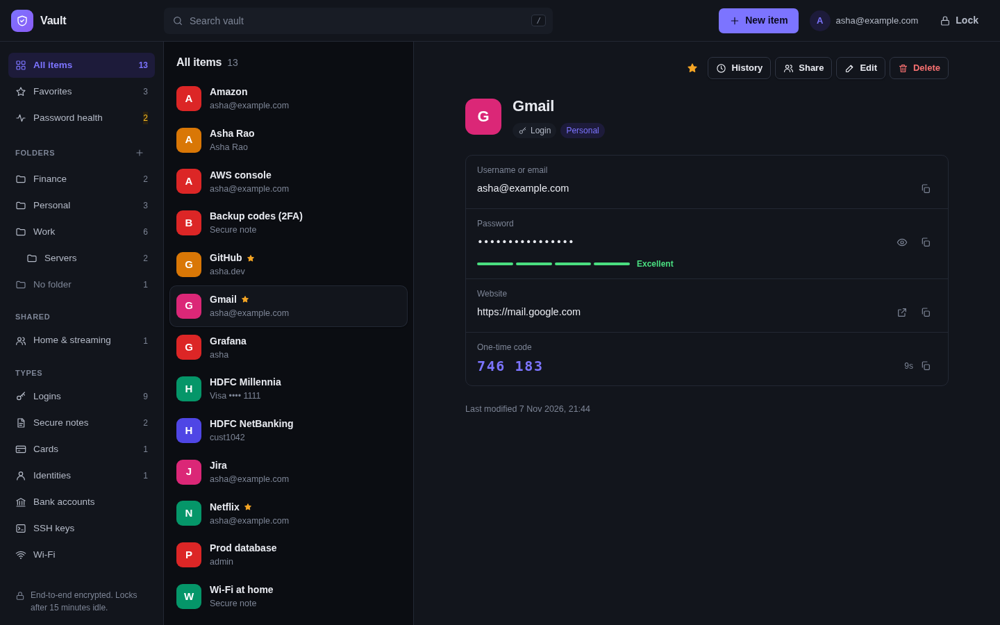
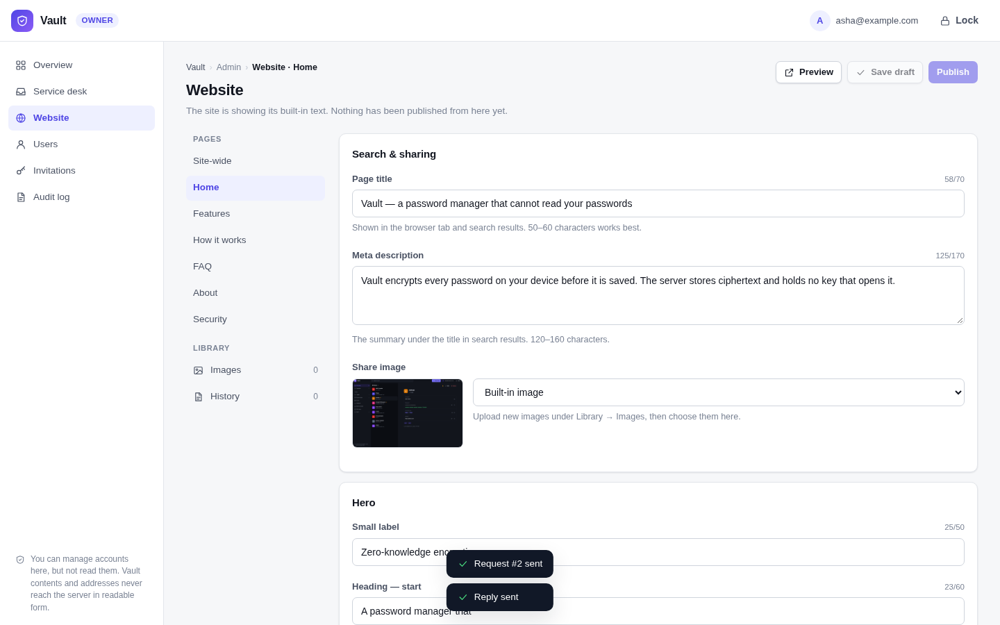

# User guide

How to use Vault, screen by screen. Every screenshot is of the real product with made-up
data, taken by `npm run screenshots` (see [Keeping these screenshots current](#keeping-these-screenshots-current)).

<details>
<summary><b>Contents</b></summary>

- [How Vault keeps your data private](#how-vault-keeps-your-data-private)
- [Getting started](#getting-started)
- [The vault](#the-vault)
- [Folders and history](#folders-and-history)
- [Password health](#password-health)
- [Import and export](#import-and-export)
- [Account settings](#account-settings)
- [Devices and activity](#devices-and-activity)
- [On a phone, and in dark mode](#on-a-phone-and-in-dark-mode)
- [For owners: the admin panel](#for-owners-the-admin-panel)
- [Keyboard shortcuts](#keyboard-shortcuts)

</details>

## How Vault keeps your data private



- Your **master password never leaves the browser**. The server gets a separate key derived
  from it that cannot be turned back into it.
- **Everything is encrypted** — names, websites, usernames, notes, folders, tags — not just
  passwords. The server cannot tell which sites you have accounts on.
- There is **no password reset**, because the server could not do one. The **recovery key**
  you are shown at sign-up is the only way back if you forget the master password.

## Getting started


1. Open `/app/` and choose **Create an account** — or open the invitation link you were
   emailed, which fills the code in. (On a brand-new server, the owner uses the setup link
   from the server's log instead; see [INSTALL.md](INSTALL.md#the-first-account).)
2. Pick a long master password. The strength meter is a guide; a passphrase of four or more
   unrelated words works well.
3. **Save the recovery key** shown next — print it or keep it in a safe place off this
   device. It is shown once and never sent to the server.
4. Sign in with your email and master password. If two-factor sign-in is on, enter the
   six-digit code from your authenticator app.

Forgot the master password? **Use your recovery key** on the sign-in screen, then set a new
master password.

## The vault



| Area | What it does |
|---|---|
| Left column | All items, Favorites, Password health, your folders, and each item type |
| Middle column | The items in the current view; type to search (press <kbd>/</kbd>) |
| Right column | The open item: copy any field, reveal a password, open the website, see a live **one-time code** |

**Add an item** with **New item**. Choose its type — Login, Secure note, Card, Identity,
Bank account, SSH key or Wi-Fi — and the form shows that type's own fields. Add **custom
fields** for anything else, and mark them hidden to mask them like a password.

<details>
<summary>Item types and their fields — a card, for example</summary>


| Type | Fields |
|---|---|
| Login | Username or email, password (with generator), website, one-time code key |
| Secure note | Notes only |
| Card | Name on card, number, expiry, security code, PIN — the brand is recognised from the number |
| Identity | Full name, email, phone, date of birth, address, ID number, company |
| Bank account | Bank, holder, account number, IFSC/routing, IBAN, type, PIN |
| SSH key | Host, public key, private key, passphrase |
| Wi-Fi | Network name, password, security |

</details>

<details>
<summary>Editing an item</summary>



Copying a password clears the clipboard after a short time. **Favorite** an item with the
star to pin it under Favorites.
</details>

## Folders and history


- **Folders nest** up to four levels. Hover a folder for **New folder inside**, **Rename**
  and **Delete**. Deleting a folder never deletes items: they move up a level.
- A folder's view includes everything in the folders beneath it.

**History.** Every edit that changes an item keeps the previous version, encrypted like the
item itself — up to 20 per item.


Open **History** on an item to see when it changed and what changed; open a version to see
the old password and **Restore this version**. Restoring keeps the version it replaces, so
nothing is lost either way.

## Password health


**Password health** in the left column scores your logins and Wi-Fi passwords out of 100 and
lists the ones with a problem:

| Finding | Meaning | What to do |
|---|---|---|
| **Weak** | Easy to guess: short, common, a word plus a number, a keyboard run | Replace it with a generated password |
| **Reused** | The same password is on more than one item | Give each site its own |
| **Old** | Not changed in over a year | Change it at the site, then here |
| **Unencrypted site** | The saved website starts with `http://` | Use the site's `https://` address |

The check runs in your browser. Nothing about your passwords is sent anywhere to compute it.

## Import and export

Open **Import & export** from the account menu (top right).



**Import** reads a file in your browser and shows what it found before anything is saved.

| From | Export it as |
|---|---|
| Chrome, Edge, Brave | Settings → Passwords → Export passwords (CSV) |
| Firefox | about:logins → ⋯ → Export logins (CSV) |
| Safari | File → Export → Passwords (CSV) |
| Bitwarden | Tools → Export vault → `.json` or `.csv` (not "JSON (Encrypted)") |
| 1Password | File → Export → CSV |
| LastPass | Advanced options → Export (CSV) |
| KeePass / KeePassXC | Database → Export → CSV |
| Zoho Vault | Tools → Export Secrets (CSV) |
| A Vault encrypted export | As downloaded; you will be asked for its password |
| Anything else | A CSV with recognisable column names (name/title, url, username, password…) |

Options: **skip items already in the vault** (same name, username and website), and put
everything in a new folder named for today. Folders in the file are recreated, or reused if
you already have one with the same name. **Delete the export file afterwards** — it holds
your passwords in plain text.

**Export**

- **Encrypted export** — a backup of every item and folder, locked with a password you choose
  there (12+ characters). It can be imported on any Vault server. Keep the password apart
  from the file.
- **Plain CSV** — for moving to another password manager. Asks for your master password and
  an acknowledgement, because the file is not encrypted.

## Account settings


| Section | What it does |
|---|---|
| Master password | Change it. Other devices are signed out. Your items are not re-encrypted, so it is instant |
| Two-factor sign-in | Turn on TOTP with any authenticator app; you get ten single-use recovery codes |
| Recovery key | Issue a new one; the old one stops working at once |
| Identity key | A fingerprint to compare with someone before sharing with them |

## Devices and activity


- **Signed-in devices** lists every browser signed in to your account, with the address it
  signed in from and when it was last active. Rename one (✎) to recognise it, or **Sign out
  device**. **Sign out everywhere** signs out all of them, this one included.
- **Locking** — the Lock button, 15 minutes idle, or closing the tab — signs this browser out
  on the server too.
- **Security activity** shows sign-ins and account changes from the last 90 days.

If you see a device you do not recognise: sign it out, then change your master password.

## On a phone, and in dark mode

The same app adapts to a phone and follows your system's light or dark setting.

<p>

&nbsp;

</p>



## For owners: the admin panel

Staff with a role see **Admin panel** in the account menu. What each role can do:

| | Owner | Admin | Marketing | Viewer |
|---|:-:|:-:|:-:|:-:|
| Overview | ✓ | ✓ | | ✓ |
| Users: label, disable, sign out, reset 2FA, delete | ✓ | ✓ | | read |
| Change roles | ✓ | | | |
| Invitations (copy the code, or email it) | ✓ | ✓ | | read |
| Registration mode (closed / invite / open) | ✓ | ✓ | | read |
| Website: edit text, SEO, images | ✓ | ✓ | ✓ | read |
| Website: publish, roll back | ✓ | ✓ | ✓ | |
| Audit log | ✓ | ✓ | | ✓ |

<details>
<summary>Overview</summary>


Counts, the last verified backup, the registration mode (closed, invite only, open), whether
mail is set up (with **Send test**), and the server's state. (Taken on the local development stack, which has no backups and forces
registration open — hence the two notices.)
</details>

<details>
<summary>Website editor</summary>



Edit any page's text, search title and description, and images; **Preview**, **Save
draft**, then **Publish**. Every published version is kept and can be restored. Text is
escaped, never run, because the website shares its address with the vault.
</details>

Nobody in the admin panel — the owner included — can read anyone's vault.

## Keyboard shortcuts

| Key | Action |
|---|---|
| <kbd>/</kbd> | Search |
| <kbd>Esc</kbd> | Close the editor, then the open item |

## Keeping these screenshots current

```sh
npm run build
npm run screenshots     # starts the in-memory stack, imports a demo vault, writes docs/images/
```

The script is `scripts/screenshots.mjs`. Run it after any visible change, so this guide
never shows an older product than the one that ships.
