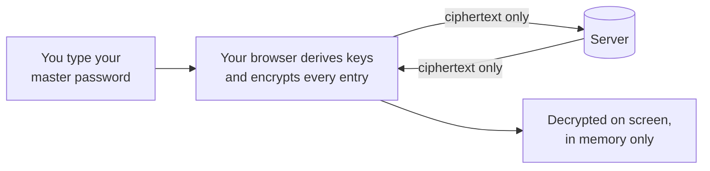
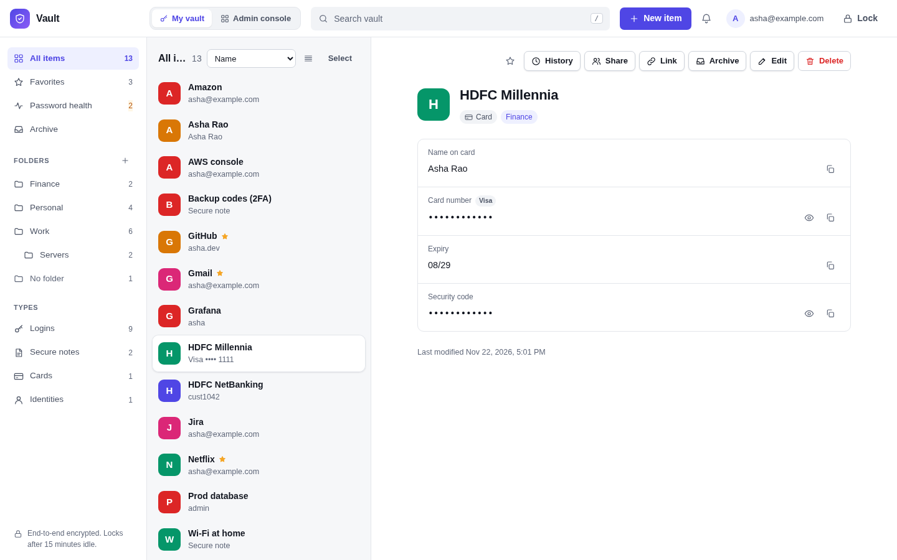
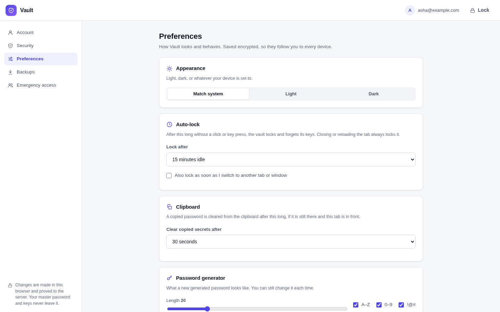
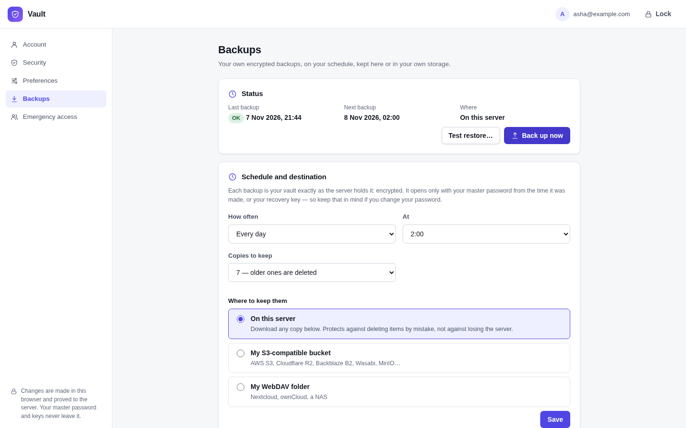
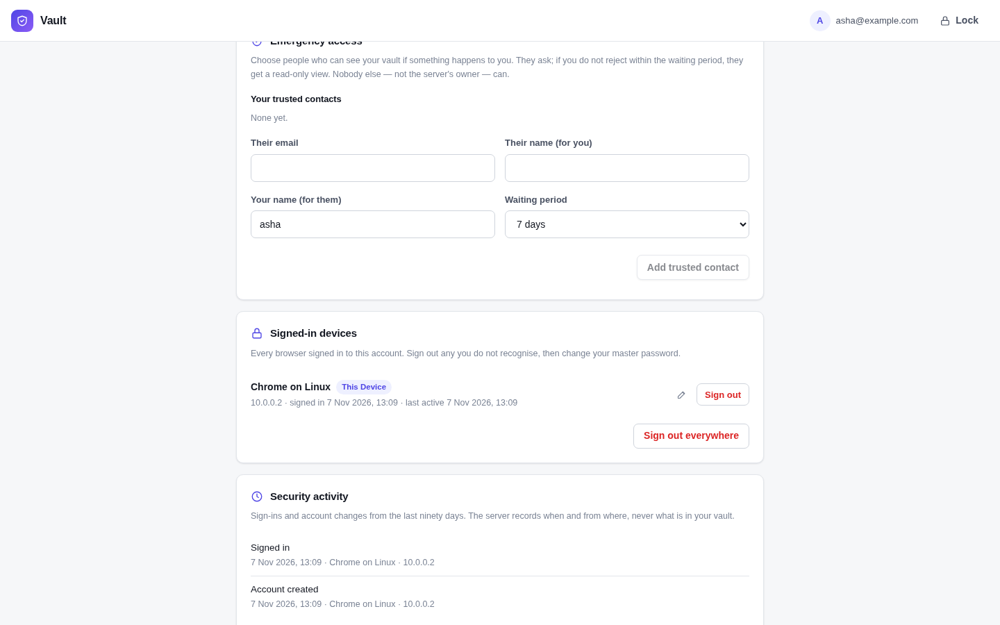
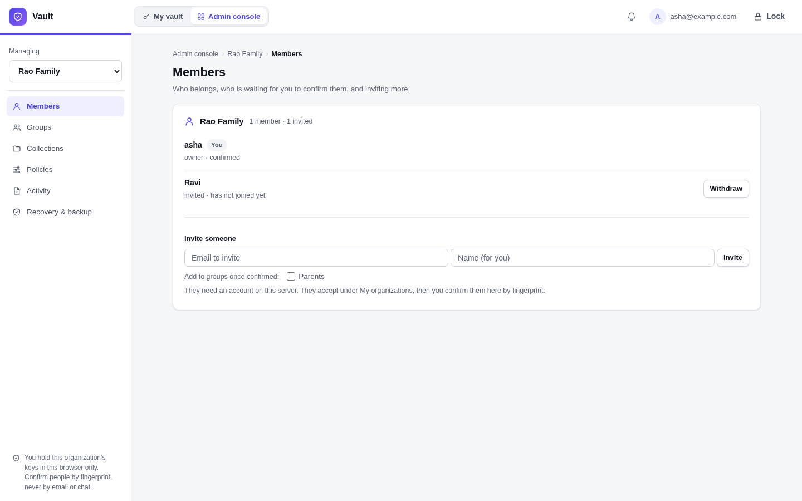
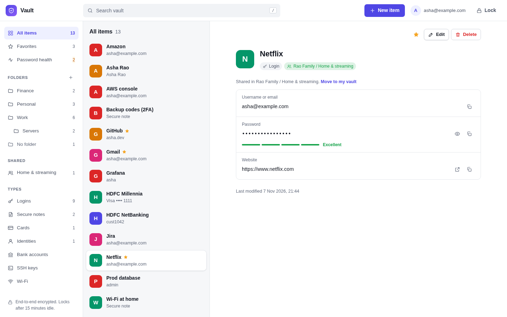
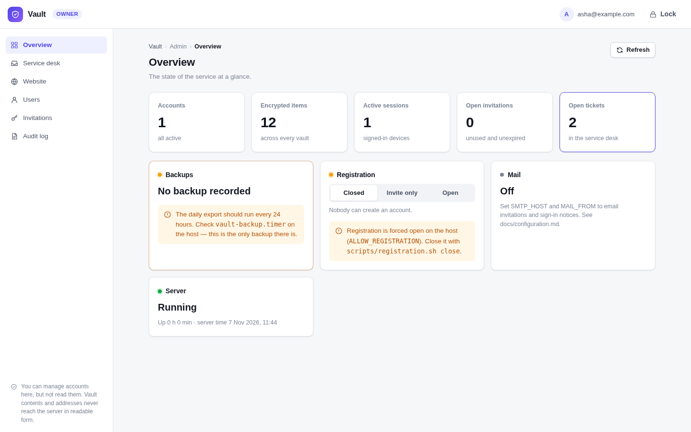

# User guide

How to use Vault, screen by screen. Every screenshot is of the real product with made-up
data, taken by `npm run screenshots` (see [Keeping these screenshots current](#keeping-these-screenshots-current)).

<details>
<summary><b>Contents</b></summary>

- [How Vault keeps your data private](#how-vault-keeps-your-data-private)
- [Getting started](#getting-started)
- [The vault](#the-vault)
- [Folders and history](#folders-and-history)
- [Password health](#password-health)
- [Import and export](#import-and-export)
- [Account settings](#account-settings)
- [Devices and activity](#devices-and-activity)
- [Sharing with an organization](#sharing-with-an-organization)
- [Help and support](#help-and-support)
- [On a phone, and in dark mode](#on-a-phone-and-in-dark-mode)
- [For owners: the admin console](#for-owners-the-admin-console)
- [For staff: the service desk](#for-staff-the-service-desk)
- [Keyboard shortcuts](#keyboard-shortcuts)

</details>

## How Vault keeps your data private



- Your **master password never leaves the browser**. The server gets a separate key derived
  from it that cannot be turned back into it.
- **Everything is encrypted** — names, websites, usernames, notes, folders, tags — not just
  passwords. The server cannot tell which sites you have accounts on.
- There is **no password reset**, because the server could not do one. The **recovery key**
  you are shown at sign-up is the only way back if you forget the master password.

## Getting started


1. Open `/app/` and choose **Create an account** — or open the invitation link you were
   emailed, which fills the code in. (On a brand-new server, the owner uses the setup link
   from the server's log instead; see [INSTALL.md](INSTALL.md#the-first-account).)
2. Pick a long master password. The strength meter is a guide; a passphrase of four or more
   unrelated words works well.
3. **Save the recovery key** shown next — print it or keep it in a safe place off this
   device. It is shown once and never sent to the server.
4. Sign in with your email and master password. If two-factor sign-in is on, enter the
   six-digit code from your authenticator app.

Forgot the master password? **Use your recovery key** on the sign-in screen, then set a new
master password.

## The vault

**Get started.** A new vault shows a short checklist beside the list: add or import your first
items, turn on two-factor sign-in, set up backups, and keep your recovery key safe. Steps tick
themselves off as you do them; **Hide this** puts it away.


| Area | What it does |
|---|---|
| Left column | All items, Favorites, Password health, your folders, and each item type |
| Middle column | The items in the current view; type to search (press <kbd>/</kbd>) |
| Right column | The open item: copy any field, reveal a password, open the website, see a live **one-time code** |

**Attach files** in the editor with **Attach a file**: scans, licence files, a recovery sheet,
up to 2 MB each. Each file is encrypted in your browser with its own key before it is uploaded,
and **Download** on the item decrypts it again. Files are kept with your item and in your
personal backups. They are not shared with the item, and not included in exports or share links.

**Add an item** with **New item**. Choose its type — fifteen of them, grouped as Everyday,
Money, Documents and Technical — and the form shows that type's own fields. The left column
lists a type once you have an item of it. Add **custom
fields** for anything else, and mark them hidden to mask them like a password.

<details>
<summary>Item types and their fields — a card, for example</summary>



| Type | Fields |
|---|---|
| Login | Username or email, password (with generator), website, one-time code key |
| Secure note | Notes only |
| Card | Name on card, number, expiry, security code, PIN — the brand is recognised from the number |
| Identity | Full name, email, phone, date of birth, address, ID number, company |
| Bank account | Bank, holder, account number, IFSC/routing, IBAN, type, PIN |
| SSH key | Host, public key, private key, passphrase |
| Wi-Fi | Network name, password, security |
| API credential | Service, key ID, secret or token (with generator), endpoint, scopes, expiry |
| Database | Type (PostgreSQL, MySQL…), host, port, database, username, password, connection string |
| Server | Host or IP, username, password, admin console, hosting provider |
| Software licence | Product, version, licence key, licensed to, email, purchased, expiry |
| Passport | Full name, number, country, nationality, date of birth, place of issue, issued, expiry |
| Driving licence | Full name, number, country or state, vehicle classes, date of birth, issued, expiry |
| Membership | Organization, member name, member or policy number, PIN, website, phone, expiry |
| Crypto wallet | Wallet, receiving address, recovery phrase (masked), wallet password, PIN |

Dates are written in your locale's style, and an expiry date that has passed shows
**Expired**.

</details>

<details>
<summary>Editing an item</summary>


Copying a password clears the clipboard after a short time. **Favorite** an item with the
star to pin it under Favorites.
</details>

**Archive.** An item you no longer use but want to keep: open it and choose **Archive**. It
leaves your lists, counts, search and the health check, and waits under **Archive** in the
sidebar until you **Restore** it. (Shared items cannot be archived — that would hide them from
everyone.)

**Passwords or passphrases.** The generator makes either. A passphrase is several random words
from the EFF list (six words ≈ 78 bits), easier to type on a phone or read out. Pick which one it
offers first, and its shape, in Settings → Preferences.

## Folders and history


- **Folders nest** up to four levels. Hover a folder for **New folder inside**, **Rename**
  and **Delete**. Deleting a folder never deletes items: they move up a level.
- A folder's view includes everything in the folders beneath it.

**History.** Every edit that changes an item keeps the previous version, encrypted like the
item itself — up to 20 per item.


Open **History** on an item to see when it changed and what changed; open a version to see
the old password and **Restore this version**. Restoring keeps the version it replaces, so
nothing is lost either way.

## Password health


**Password health** in the left column scores the passwords of your logins, Wi-Fi, databases and servers out of 100 and
lists the ones with a problem:

| Finding | Meaning | What to do |
|---|---|---|
| **Weak** | Easy to guess: short, common, a word plus a number, a keyboard run | Replace it with a generated password |
| **Reused** | The same password is on more than one item | Give each site its own |
| **Old** | Not changed in over a year | Change it at the site, then here |
| **Unencrypted site** | The saved website starts with `http://` | Use the site's `https://` address |
| **Breached** | Found in known data breaches (after **Check for breaches**) | Change it everywhere it is used |
| **Change due** | You set **Remind me to change the password** on the item (every 30, 90 or 180 days, or yearly) and the time has passed | Change it at the site, then here |
| **Seen by someone who left** | A shared item someone who has since left the organization could open | Change it at the site, then here |
| **Expired** / **Expiring soon** | A card, passport, licence, membership or API credential whose expiry date has passed, or falls within 30 days (not scored) | Renew it, or update the date |

These checks run in your browser. **Check for breaches** is the one exception, and only when you
press it: for each password it sends just the first 5 characters of its SHA-1 hash, through
your server, to Have I Been Pwned. The answer covers hundreds of passwords, and your browser
picks out the match itself. Results are forgotten when the vault locks. Your server's operator
can turn this off.

## Import and export

Open **Import & export** from the account menu (top right).


**Import** reads a file in your browser and shows what it found before anything is saved.

| From | Export it as |
|---|---|
| Chrome, Edge, Brave | Settings → Passwords → Export passwords (CSV) |
| Firefox | about:logins → ⋯ → Export logins (CSV) |
| Safari | File → Export → Passwords (CSV) |
| Bitwarden | Tools → Export vault → `.json` or `.csv` (not "JSON (Encrypted)") |
| 1Password | File → Export → CSV |
| LastPass | Advanced options → Export (CSV) |
| KeePass / KeePassXC | Database → Export → CSV |
| Zoho Vault | Tools → Export Secrets (CSV) |
| A Vault encrypted export | As downloaded; you will be asked for its password |
| Anything else | A CSV with recognisable column names (name/title, url, username, password…) |

Options: **skip items already in the vault** (same name, username and website), and put
everything in a new folder named for today. Folders in the file are recreated, or reused if
you already have one with the same name. **Delete the export file afterwards** — it holds
your passwords in plain text.

**Export**

- **Encrypted export** — a backup of every item and folder, locked with a password you choose
  there (12+ characters). It can be imported on any Vault server. Keep the password apart
  from the file.
- **Plain CSV** — for moving to another password manager. Asks for your master password and
  an acknowledgement, because the file is not encrypted.

## Account settings

Account menu → **Account settings**. It has four sections, each with its own address, so a
link such as `/app/settings/security` opens the right one after you unlock.


| Section | What is in it |
|---|---|
| **Account** | Your details; delete your account (master password, two-factor code and a typed DELETE; export first); change the master password (other devices are signed out, nothing is re-encrypted, so it is instant); issue a new recovery key; add a secret key (below); your identity-key fingerprint |
| **Security** | Two-factor sign-in (TOTP with any authenticator app, plus ten single-use recovery codes); signed-in devices; security activity |
| **Preferences** | Theme, auto-lock, clipboard clearing and the password generator's defaults — see below |
| **Backups** | Your own encrypted backups, on your schedule, here or in your own storage — see below |
| **Emergency access** | People you trust to reach your vault if something happens to you |

### Secret key (optional)

**Account → Secret key → Add a secret key** mixes a random 128-bit key into your master
password. Even someone with a full copy of the server then has nothing to guess your
password against. Vault shows it once in an **Emergency Kit**: the server address, your
email, the key (`SK1-…`), and a blank line where you write your master password by hand.
Print it or write it down.

- This browser keeps the key, sealed with a device key that cannot be copied out.
- Each new browser asks for it once, at sign-in. A typo is caught before anything is sent.
- Adding or removing it signs out your other devices, like a password change. Nothing is
  re-encrypted.
- Lost it? Your recovery key still works. A reset on a browser that does not hold the secret
  key turns it off, and you can add a new one.
- Backups and offline copies made while it is on need it too. A personal backup opens with
  this browser's copy, or with the recovery key.
- If a browser that holds the key is told by the server that the account has none, sign-in
  stops. Choose *forget the secret key on this browser* only if you removed it yourself.

### Preferences



| Setting | Choices | Default |
|---|---|---|
| Appearance | Match system · Light · Dark | Match system |
| Auto-lock | 1, 5, 15, 30 minutes, 1 or 4 hours idle | 15 minutes |
| Lock when I switch tab or window | on / off | off |
| Clear copied secrets after | 10, 30 seconds, 1 or 2 minutes, never | 30 seconds |
| Masked passwords show | the same dots for every password · one dot per character | the same dots (hides the length) |
| Hide a revealed secret again after | 10, 30 seconds, 1 minute, keep it shown | 30 seconds |
| Put new items in | No folder, or any folder (used when no folder is open) | No folder |
| Dates | as the browser does · 31/12/2026 · 12/31/2026 · 2026-12-31 | as the browser does |
| Times | as the browser does · 24-hour · 12-hour | as the browser does |
| Language | as the browser does · English · हिन्दी (Hindi) · Español (Spanish). The main screens are translated so far; the rest shows in English | as the browser does |
| Email alerts | email me when my account signs in (when the server sends mail) | on |
| Password generator | default length (8–64) and character sets | 20, all sets |

Preferences are **encrypted with your vault key** and saved on the server, so they follow you to
every device, and the server cannot read them. The one exception is the email alert switch,
which the server has to read to know whether to write to you. The server keeps only a
fingerprint of your address, so it can email you only as you sign in. Alerts about other
events, such as a share link being opened, appear in **Security activity** instead. An organization can set a shorter auto-lock than
yours; when it does, the section says so.

### Backups

**Offline copy.** At the bottom of Backups, **Download an offline copy** saves one HTML file you
can keep on a USB stick or another computer. It opens in any browser with your master password,
with no server and no network: for when this server is down or gone. It is read-only, it is as
strong as your master password at the time, and it leaves out attached files.



Settings → **Backups** keeps your own copies of your vault, independent of the server's backups.

- **How often**: off (only **Back up now**), every day, every week on a day you pick, or every
  month on the 1st — at an hour you choose, in your time zone.
- **Where**: **on this server** (download any copy; protects against deleting something by
  mistake, not against losing the server), **your S3-compatible bucket** (AWS, R2, B2, Wasabi,
  MinIO…), **your WebDAV folder** (Nextcloud, ownCloud, a NAS), or **Google Drive** or
  **OneDrive** when your server offers them.
- **Copies to keep**: older ones are deleted at the destination. At most 10 are kept on the server.
- **History** lists every run and, when one fails, why.
- **Test restore** fetches the newest copy and opens it in your browser, proving it can be
  restored, without importing anything.

Each backup is your vault exactly as the server holds it: encrypted. It opens only with the
**master password you had when it was made**, or the recovery key from that time. If you change
your master password, older backups still need the old one.

**To restore**, download a copy (or take it from your bucket or folder), then Import & export →
choose the file → enter that master password. Items are added to your vault; nothing is
replaced. Duplicates are skipped if you leave that option on.

For S3 or WebDAV, the server keeps the secret key or password encrypted so it can back up while
you are away. Create one that can write only to that bucket or folder.

**Google Drive and OneDrive:** choose one, then **Connect** and allow Vault at Google or Microsoft.
You come back to Vault and sign in again, because the page reloads. Vault asks for the least it can:
- on Google Drive, only the files it creates (a *Vault backups* folder);
- on OneDrive, only its own app folder (*Apps → Vault*).

It can see nothing else in your drive. To stop, choose another destination, then remove Vault
from your Google or Microsoft account's connected apps.

## Notifications

The **bell** at the top shows what happened while you were away: a share link opened, an
invitation, someone accepting yours (confirm them), an access request or its answer, a
check-out ending, a sensitive item opened, a scheduled backup that failed, an emergency access
request. Choose one to go where it matters, or **Mark all read**. Notifications are kept as long
as account activity (90 days unless your administrator changes it). They name people by the
label your organization gave them, never an item's name, which the server cannot read.

### Passkeys and security keys

**Settings → Security → Passkeys and security keys → Add a passkey or security key.** Use a
hardware key (YubiKey, Titan) or a passkey on your device (Windows Hello, Touch ID, Android) as
your second factor at sign-in, instead of or alongside an authenticator app. A key only answers
this server's real address, so a look-alike phishing page gets nothing. Your first second factor
comes with ten recovery codes; save them. Removing a key asks for your master password and a
second factor. Your master password still unlocks the vault: a key protects signing in.

### Creating an account

The sign-in page has two tabs, **Sign in** and **Create an account**. Choose
**Create an account**:
1. Type your email. It is your username. (*Continue with Google* and *Continue with Microsoft*
   are shown as coming soon; they are not available yet.)
2. We email a 6-digit code. Type it, and choose an **account password**.
3. That makes your account. Your vault comes next:
   - if the server is open to everyone, choose a **master password** and save your recovery key;
   - if it is by invitation, **send a request for a vault** (with a note, if you like), or enter
     an invitation code. You get an email when the request is approved; sign in again and create
     your vault.

### Which emails Vault sends

Only the ones you need:
- the sign-up code;
- an invitation;
- a reset link for a forgotten account password;
- the note that a vault request was approved.

These are always sent:
- a warning when your **recovery key** was used to sign in;
- to owners and admins, a note when someone changes a role, the policies or registration, or
  deletes an account.

An email on every sign-in is **off** unless you turn it on (Settings → Preferences → *Email me
when my account signs in on a device*). The weekly admin summary is off unless an owner turns it
on.

### Signing in: account password, then master password

Signing in has two steps:
1. **Your account:** your email and **account password**, plus your two-factor code if it is on.
2. **Your vault:** your **master password**, which opens it in this browser.

This browser remembers step 1, so after a lock or a reload you type only the master password.
**Account menu → Sign out of this device** makes it forget, and the next sign-in starts with
the account again. The two passwords must be different.

The sign-in tab holds only your email, account password and **Continue**. Every other way in is
under **Other ways to sign in**: a passkey, your master password, your recovery key, an
invitation code, a request for access, and help.

- **Forgot the account password?** Use *Forgot password?* next to the account password field. A
  link arrives by email. If the server sends no email, ask the person who runs it.
- **Forgot the master password?** Only your recovery key can help.
- **Change the account password** in Settings → Security. Other devices then sign in again.
- **An account from before account passwords:** choose *Other ways to sign in → Use my master
  password* once. Vault then asks you to choose an account password.

### Signing in with your company account (single sign-on)

If your administrator set it up, the sign-in screen offers **Sign in with** your company's
provider (Okta, Microsoft, Google…). Sign in there as usual. You come back to Vault with your
address filled in, and enter your **master password**. The provider proves who you are, but only
your master password opens your vault: your company's provider cannot read it. If your
administrator requires single sign-on, the provider is the only way in, for passkeys and the
recovery key too.

### Passkeys for websites (browser extension)

In the extension's popup, turn on **Save and use passkeys in Vault**. When a site offers to
create a passkey, Vault asks **Save a passkey for example.com?**:
- **Save in Vault** keeps the passkey, encrypted in that site's login, on all your devices;
- **Use another device** leaves it to your browser or phone.

When the site asks you to sign in with a passkey, Vault lists the ones it has for that site. It
never offers a passkey to a different site. Your vault must be unlocked; if it is not, the card
says so. The login item in Vault shows its passkeys, and you can remove one in **Edit**. Remove
it in the site's security settings as well.

### Upgrade key derivation

Vault turns your master password into keys with **Argon2id**. Every guess costs 64 MiB of
memory, which makes guessing far slower on graphics cards. Accounts made before that used PBKDF2.
If yours did, **Settings → Security → Upgrade key derivation** asks for your master password
once and re-derives your keys. The password stays the same and nothing in the vault changes.
Other devices are signed out, as after a password change. Changing your master password upgrades
it as well.

### Unlock with a passkey

**Settings → Security → Unlock with a passkey → Add a passkey to unlock.** After that, the sign-in
screen's **Sign in with a passkey** opens your vault with Touch ID, Windows Hello, your phone or
a security key. You type no email and no master password. The passkey's secret opens the vault
in your browser, and the server never sees it. Your master password keeps working.

- **Anyone who can use the passkey can open your vault.** That means your device plus its PIN
  or fingerprint. Add passkeys only on devices you alone use. A passkey synced to your Apple or
  Google account is as safe as that account.
- **It counts as two factors.** No authenticator code is asked for.
- **Not every device can do it.** The passkey needs the PRF extension: current Chrome, Edge and
  Safari, Windows Hello, Android, and recent security keys. If yours cannot, Vault says so and
  saves nothing. Delete the passkey it just made from your device's list.
- **Removing one** in the same card stops it opening the vault at once.

## Devices and activity



- **Signed-in devices** lists every browser signed in to your account, with the address it
  signed in from and when it was last active. Rename one (✎) to recognise it, or **Sign out
  device**. **Sign out everywhere** signs out all of them, this one included.
- **Locking** — the Lock button, the auto-lock (15 minutes idle unless you change it in
  Preferences), or closing the tab — signs this browser out on the server too.
- **Security activity** shows sign-ins and account changes from the last 90 days (your server's administrator can change how long).

If you see a device you do not recognise: sign it out, then change your master password.

## Sharing one item by link

To give one item to someone without an account (a contractor, a relative, a new colleague),
open it and choose **Link**. Pick how long the link lasts (1 hour to 30 days) and how many
times it can be opened (once, 2, 5, 10, or no limit), then **Create link** and copy it.

- The link holds its own key after the `#`. Vault never receives that key, so it cannot show
  you the link again. Copy it straight away.
- The person opens it in any browser and chooses **Open it**. A chat app's preview does not use
  up a view.
- They get a copy of the item as it was when you shared it. Later edits are not in the copy.
- **Settings → Security → Share links** shows each link (live, used up, expired, revoked) and how
  often it was opened, with **Revoke** for live ones. Every open also shows in your activity.
- Anyone who has the whole link can open it, so send it over a channel you trust.

## Sharing with an organization

*Business and hosted editions. A personal Vault has one account, so it has no one to share with ([0030](../decisions/0030-editions.md)).*

Vault keeps using an organization apart from running one
([0031](../decisions/0031-two-workspaces.md)):

- **My organizations** (account menu) is every member's view. It shows the teams you belong to,
  what each shares with you, a way to ask for more collections, invitations to accept, your
  fingerprint, and **New organization**.
- **Admin console** is for owners and admins. Use the switch at the top, *My vault* |
  *Admin console*, and choose the organization under **Managing**. Its sections are **Members**,
  **Groups**, **Collections**, **Policies**, **Activity** and **Recovery & backup**.



1. **Create an organization** under My organizations. You become its owner, see its recovery
   key once, and land in its Admin console. Add **collections** there, such as "Finance" or
   "Home & streaming".
2. **Invite** people by email address under **Members**, and tick the **groups** they should
   join. They see the invitation when they next sign in, and **Accept** it under My
   organizations.
3. **Confirm them.** Ask them to read out the fingerprint shown on their My organizations
   page — on a call or in person — and press **Confirm…** next to their name in **Members**.
   Confirm only if it matches what you see. This is what stops anyone, the server included,
   from slipping in a key of their own. Confirming also adds them to the groups chosen at
   invitation, with the groups' collections.
4. In **Collections**, open a collection's **Access** and give confirmed members, or a group,
   a **permission set** ([0032](../decisions/0032-business-edition.md)):
   - **Use only**: fill logins without seeing their passwords;
   - **Viewer**: open items and see their passwords;
   - **Editor**: add and change items;
   - **Manager**: also give others access.

   **Password health** in the console shows weak, reused, old and breached passwords across the
   collections you manage. It is worked out in your browser, and you fix items from your vault
   under **Shared**.

   Make your own sets under **Permission sets**, choosing what items allow, whether passwords
   can be seen and copied, whether the browser extension may fill them, and whether items can
   go into backups or be moved out. These are rules the apps keep, not encryption: anyone who
   can open a collection holds its key.

**In a business Vault** ([0032](../decisions/0032-business-edition.md)) the server is one
company. The owner creates it once, and the console's **People** section is where everyone is
managed:

- **Invite by email address.** Someone without an account gets a single-use sign-up code,
  emailed if mail is set up and shown to you otherwise. They sign up, accept, and you confirm
  them by fingerprint.
- **Add to company.** Accounts already on the server but not in the company are listed under
  *On this server, not in …*, with **Add to company**.
- **Guests.** Invite someone *as a guest* (Invite as → Guest), with an optional end date. A
  guest sees only the collections you give them, not the other members or groups, and cannot ask
  for more. When the date passes, their access ends by itself.
- **Each person's account.** An admin who also manages accounts sees each person's last sign-in
  and two-factor status, with **Account** actions: disable sign-in, reset two-factor, offboard.

**On a hosted Vault** ([0033](../decisions/0033-hosted-edition.md)), companies are invited by
the people who run the server. They send the company's admin a code from *Tenants → Invite a
company*. The admin signs up with it, creates the company under My organizations, and runs it
from the Admin console. Other accounts are personal: they cannot create organizations, but can
still share an item with one person.

**Share with one person.** Open an item, choose **Share**, and type the address of someone
with an account on this server. Vault makes a private space for the two of you (shown in
My organizations as a **Direct share**, where you also confirm them), moves the item into it,
and invites them. Once they
accept and you confirm their fingerprint, they can open and edit it. Further items shared with
the same person go into the same space. Removing them works like any member removal.

**Share an item with a team** by opening it and choosing **Share** → a collection. It moves into the
collection, re-encrypted with the collection's key; everyone with access sees it under
**Shared** in the sidebar. **Move to my vault** takes it back.



**Removing someone** cuts their access at once, and your app re-keys every collection they
could open (a new key, every item re-encrypted) so a copy they kept opens nothing new. If you
cannot manage one of them, it shows **Rotate key** for someone who can.

A new key does not change the passwords they already saw. Every item in those collections
is listed in **Password health** as **Seen by someone who left**, for everyone who can still
open it, until someone changes its password. Change it at the site, then in Vault, and the
mark goes.

**Groups** — "Parents", "Engineering" — let you give a whole team access to a collection at
once: create a group, add confirmed members, then in a collection's **Access** choose **Give
access to a group**. People added to the group later get the group's collections.

**Signed keys.** Every key someone shares with you in an organization is signed by its owner
or an admin the owner trusts, and your app checks the signature before using it. A collection
whose key does not check out shows **Key not trusted** and stays closed: ask an admin to share it
again. Your fingerprint now covers two keys, one for sharing and one for signing, so it changed
once when your app added the second. Admins see **Re-confirm…** next to members whose fingerprint
changed: compare it with them, as when you first confirmed them. If an organization's owner key
ever changes (for example after a recovery), you will see *The owner's key changed*; compare the
new owner's fingerprint before trusting it.

**Recovery key.** Creating an organization shows its **recovery key** once: keep it offline. If
every owner and admin ever loses access, any member can choose **Recover with the recovery
key…**, enter it, and become the owner, with every collection the key covers. The owner can
**Replace the recovery key** (the old one stops working), and the organization card shows how many
collections it covers. Collections are added to it automatically when someone who manages them
opens the organization.

**Joining one.** After you accept an invitation, the vault shows a note with your fingerprint
until an admin confirms you: read it to them on a call or in person. Once you are confirmed, it
tells you once where shared items appear.

**Asking for a collection.** Members see every collection's name, including ones they cannot
open, with **Request access** (and an optional reason). The owner and admins are notified and
find the request under **Access requests** on the organization. **Approve** gives access for
good or as a **check-out** (1 hour to 1 week), which ends by itself: the collection is then
marked for a key rotation and the person is told. **Decline** tells them too.

**Sensitive items.** Someone who manages a collection can tick **Tell the admins whenever
someone opens this** on an item. Each time a member opens, reveals or copies it, the owner and
admins get a notification. Like the activity log, this relies on each person's app reporting it.

**Policies…** (admins) can require two-factor sign-in, a minimum master password strength and a
shorter idle lock. They apply to everyone in the organization, you included; anyone who does
not meet them is told why and cannot open its collections until they do.

**Back up this organization…** (admins) downloads an encrypted file of every item in the
collections you can open, each collection as a folder, protected by a password you choose. It
opens in **Import & export**, on this server or another.

**Activity…** (admins) shows who opened, copied, edited, shared or removed what, for a year.

### Emergency access

*Business and hosted editions. A personal Vault has one account, so it has no one to share with ([0030](../decisions/0030-editions.md)).*

Settings → **Emergency access**: choose someone you trust and a waiting period. After they
accept, confirm their fingerprint (they see their own fingerprint on the same page, ready to read
out to you). If they ever request access, you will see it in this section —
**Reject** it, or **Approve now**; if you do nothing, they get a read-only view of your vault
when the waiting period ends. Use this for the person who should be able to get in if something
happens to you.


## The browser extension

Fill passwords without opening Vault: the extension for Chrome and Firefox
([0029](../decisions/0029-browser-extension.md)).

1. **Install.** Until it is in the stores, load it from a release: download
   `vault-extension-chrome-*.zip` or `vault-extension-firefox-*.zip` and unzip it. In
   Chrome, open `chrome://extensions`, turn on *Developer mode*, and choose *Load unpacked*.
   In Firefox, open `about:debugging` → *This Firefox* → *Load Temporary Add-on*.
2. **Connect.** Click the Vault button in the toolbar and enter your server's address, the one
   you open Vault at. The extension asks to reach that address, and no other.
3. **Unlock** with your email and master password, plus your secret key the first time if you
   have one. A second factor works with an authenticator app or a recovery code. A security
   key cannot be used from an extension.

On a login page, open the extension: logins saved for that site are listed first. Click **Fill**,
or press **Ctrl+Shift+L** (⌘⇧L on a Mac) to fill the best match without opening it. **User**,
**Pass** and **Code** copy the username, the password, or the current two-factor code.

- It fills only logins whose saved website matches the page: the same address, or the same
  site over https (`accounts.example.com` for `www.example.com`). A look-alike address gets
  nothing.
- It cannot read or change any page until you click it or press the shortcut.
- **Inside pages (optional).** In the popup, turn on *Show Vault in login fields and offer to
  save passwords*. Your browser asks for access to the sites you visit. Then:
  - a Vault icon appears in login fields and lists that site's logins;
  - in a sign-up form, it offers **Generate a strong password**;
  - after you sign in with a new or changed password, it asks to **Save** or **Update**.

  It never runs on your Vault server's own pages. Turn it off in the same place.
- Items shared with you through an organization appear too, labelled with their collection
  (*Acme / Finance*). If the organization hides passwords, you can fill them but not copy them.
  Filling or copying a shared item shows in the organization's activity.
- It locks after your account's idle limit (15 minutes unless your organization sets one), when
  you click **Lock**, and when the browser closes.

## Help and support

**No account yet, or locked out?** On the sign-in screen, choose **Other ways to sign in**:

- **Request access** — tell the people who run the server who you are. If they approve, you
  get an invitation by email.
- **Ask for help** (lost your authenticator, or still can't sign in) — they confirm it is really you
  (by phone or in person) and turn off two-factor sign-in so you can set it up again. Nobody
  can reset a forgotten master password; that is what the recovery key is for.


Your email address is kept only until the request is closed, then erased.

If the people running the server have set a support address, it is shown under the sign-in
form and on the Help & support page, and replies to any email Vault sends reach them.

**Signed in?** Account menu → **Help & support** → **New request**. Choose what it is about,
describe it, and optionally have replies emailed to you. The conversation stays on the page:
reply there, or close the request when you are done. Staff can read what you write but never
your vault — **never put a password, recovery key or code in a request.**

## On a phone, and in dark mode

The same app adapts to a phone. It follows your system's light or dark setting unless you pick
one in Settings → Preferences; on a phone, the settings sections are the chips along the top.

<p>

&nbsp;

</p>


## For owners: the admin console

*In a personal Vault this is **Server settings**, with only what one person needs: Overview (backups, mail, name, sign-in rules), the audit log and System.*

Staff with a role see the *My vault* | *Admin console* switch at the top. Under **Managing**,
choose the server (organizations you run are listed there too). What each role can do on the
server:

| | Owner | Admin | Support | Marketing | Viewer |
|---|:-:|:-:|:-:|:-:|:-:|
| Overview | ✓ | ✓ | | | ✓ |
| Service desk: read tickets | ✓ | ✓ | ✓ | | ✓ |
| Service desk: reply, assign, approve access | ✓ | ✓ | ✓ | | |
| Service desk: reset two-factor for a locked-out user | ✓ | ✓ | | | |
| Invitations (copy the code, or email it) | ✓ | ✓ | ✓ | | read |
| Users: label, disable, sign out, offboard, reset 2FA, delete | ✓ | ✓ | | | read |
| Change roles | ✓ | | | | |
| Registration mode (closed / invite / open) | ✓ | ✓ | | | read |
| Policies (two-factor, password strength, auto-lock, sign-in length, log retention, share links, sign-in allow-list) | ✓ | ✓ | | | read |
| System: back up now, email templates | ✓ | ✓ | | | read |
| Website: edit text, SEO, images | ✓ | ✓ | | ✓ | read |
| Website: publish, roll back | ✓ | ✓ | | ✓ | |
| Audit log | ✓ | ✓ | | | ✓ |

<details>
<summary>Overview</summary>



Counts, the last verified backup, the registration mode (closed, invite only, open), whether
mail is set up (with **Send test**), and the server's state. (Taken on the local development stack, which has no backups and forces
registration open — hence the two notices.)
</details>

<details>
<summary>Policies</summary>

Overview → **Policies** sets rules for every account on the server:

| Policy | Effect |
|---|---|
| Require two-factor sign-in | Accounts without it see a notice in the vault and in Settings, and are marked **Misses policy** in Users |
| Weakest master password | Sign-up and password change refuse anything weaker. Each person's app checks it — the server never sees a password — so an existing weaker password shows as a gap until it is changed |
| Longest auto-lock | Caps everyone's auto-lock choice. An organization's own limit can only shorten it further |
| Sign in again after | Ends every device's sign-in that many days after it signed in, however often it is used. Applies to devices already signed in |
| Share links | Allowed up to 30, 7 or 1 days, or turned off. When off, the **Link** button disappears; links already made keep working until they expire or are revoked |
| Allow sign-in only from | Addresses or ranges such as `203.0.113.0/24`, one per line; empty means anywhere. Sign-ins, recovery sign-ins and token refreshes from elsewhere are refused, so a device that leaves the network is signed out within 15 minutes. **Owners are exempt**, so a wrong list can always be fixed, and you cannot save a list that leaves out your own address |
| Keep account activity / audit and organization logs for | Older entries are deleted. Shortening a period deletes what is older at once (the panel warns first); lengthening keeps entries written from then on |

No policy locks anyone out: an account that misses one keeps working and is told what to do.
Every change is in the audit log.
</details>

<details>
<summary>First-run setup wizard</summary>

On a new server, the owner's first visit to the admin console opens **Set up this server**. It
covers the name and support address, who can join (invite only is recommended), sign-in rules
(two-factor sign-in, strong master passwords, a short auto-lock), whether mail and backups work
(with a test email), and inviting people. Any step can be skipped, and **Step by step…** on the
Overview checklist opens it again.
</details>

<details>
<summary>Overview: needs attention, sign-ins, and the weekly summary</summary>

The **Overview** opens with **Needs attention**, most urgent first:
- staff without two-factor sign-in;
- more failed sign-ins than usual today;
- accounts that miss the policy or have no two-factor sign-in;
- accounts not signed in for 90 days, or never;
- vault requests waiting;
- open service desk tickets.

**Review** opens the accounts behind an item, already filtered. When nothing needs attention,
it says so.

**Sign-ins, last 30 days** charts sign-ins and failed sign-ins per day. Hover a day for its
numbers, or open **Show as a table**. The server counts these per day only: no names, no
addresses.

**Weekly summary:** off until you turn it on under *Policies*. Then once a week, owners and admins
with an address on file get an email with the week's sign-ins and what needs attention. *Send one
now* sends it straight away. It needs mail set up.

**Reports** (in the console sidebar) has seven reports:
- two-factor sign-in per account;
- inactive accounts;
- staff roles;
- accounts that miss the policy, and why;
- sign-ins per day (90 days);
- staff actions in the last 30 days;
- organizations by members and roles.

**View** shows a report on the page and **CSV** downloads it. Reports are about accounts and
staff actions; vault contents never appear, because the server cannot read them.
</details>

<details>
<summary>Admin safety: confirming it is you, staff two-factor, change alerts</summary>

- **Confirm it is you.** Some actions ask for your master password before they run:
  - changing a role;
  - deleting or offboarding an account;
  - resetting someone's two-factor sign-in or account password;
  - bulk changes;
  - changing server settings;
  - deleting an organization.

  A sign-in counts for ten minutes, and so does confirming. After that the console asks again
  and then carries on with what you were doing.
- **Staff must use two-factor sign-in** (Overview → Policies). Staff accounts without it
  cannot open the admin console until they turn it on in Settings → Security; their own vault
  still works. You can only turn it on once your own account has two-factor sign-in.
- **Change alerts.** When someone changes a role, the policies or registration, or deletes an
  account, every other owner and admin gets an email. Check the audit log if it was not
  expected.
</details>

<details>
<summary>Hosted: running companies (seats, suspend, domains)</summary>

On a hosted server, Admin console → **Tenants** lists the companies. **Manage** opens one:

- **Seats.** Members and open invitations each take a seat. Set a limit, and at it the company
  can invite no one new until someone leaves or an invitation is withdrawn. Leave it empty for
  no limit.
- **Domains.** Add the company's domain (for example `acme.com`) and the panel shows a DNS TXT
  record, `_vault-verify.acme.com` with a `vault-verify=…` value. Once it is added at the
  domain's DNS, **Verify** checks it. A verified domain belongs to that company only.
  - People who sign up with an address at it get their vault without waiting for approval.
  - They are listed in the panel for the company's admins to invite.
  - Joining the company itself still needs an invitation and a fingerprint check: the server
    cannot hand anyone the company's keys.
- **Suspend company.** Its members keep their own vaults but cannot open the company's
  collections, and it takes no one new, until you **Resume** it. The other owners and admins
  are told by email; suspending and resuming need your master password if you have not
  confirmed it in the last ten minutes.
</details>

<details>
<summary>API tokens and SCIM provisioning (Entra ID, Okta, JumpCloud)</summary>

Admin console → **System** → **API tokens and SCIM** (owners only). A token is for a script or
for your directory. Pick a name, its **scopes** and when it expires, then **Make token**. Copy it
then: it is shown once and only a fingerprint is kept.

- **What a token can do:** it acts on accounts and invitations like staff do, within its scopes
  (`users.read`, `users.write`, `invites.read`, `invites.write`, `audit.read`,
  `overview.read`, `scim`).
- **What it can never do:** change roles or settings, manage tokens, act on admins or owners,
  or open a vault.
- **Records:** everything it does is in the audit log under the token's name. **Revoke** stops
  it at once. Making or revoking a token needs your master password if you have not confirmed
  it in the last ten minutes.
- **Calling the API:** send the token as `Authorization: Bearer vault_pat_…` to the admin API
  (`/api/admin/…`, see `docs/openapi.json`).

**SCIM 2.0:** in your directory's provisioning settings, use the **SCIM base URL** shown on the
card (`https://<your server>/api/scim/v2`) and a token with the `scim` scope as the secret
token. Vault cannot make a vault for anyone (only their master password can), so:

- **A new user** gets an emailed invitation, and is the account once they sign up with it. The
  username is the email address.
- **Deactivated** (`active: false`) disables the account and signs it out everywhere;
  reactivated enables it.
- **Deleted** offboards the account: disabled, signed out, out of every organization. The vault
  itself is kept; staff delete accounts in the console.
- **Groups** are not provisioned. Joining an organization needs its admins' fingerprint check.
</details>

<details>
<summary>Users: finding people and acting on many at once</summary>

Admin console → **Users** lists every account, a page at a time (25 to 200 rows), so it stays
quick on a server with thousands of people.

- **Search** by email, label or account id.
- **Status chips** with counts: Active, Disabled, *Inactive 90 days* and *Never signed in*.
- **Filters** by role and by two-factor sign-in, and sort by newest, last sign-in or email.
- **Select** rows (or a whole page) to disable, enable, sign out everywhere or reset two-factor
  sign-in for all of them at once. Each one is checked and recorded in the audit log as if it
  were done alone; the toast says which ones could not be done and why.
- **Export CSV** downloads the accounts that match the current search and filters.
- **Click an account** to open its panel. It shows its items, folders, devices and
  organizations (as counts and names, never contents) and the staff actions that touched it.
  The account's actions are there too: label, role, sign out everywhere, reset two-factor, reset
  the account password, disable, offboard and delete.

**Audit log** has the same kind of search, plus a filter by action and a date range; CSV and
JSON still download the whole log.
</details>

<details>
<summary>Someone leaves: Offboard</summary>

Admin console → **Users** → the account → **Offboard** does everything at once: the account is disabled,
signed out on every device, and taken out of every organization. Each organization re-keys
what they could open and lists the shared passwords they could see for colleagues to change.
It is refused while the person owns an organization: hand it over or delete it first.
**Enable** undoes the disable; organizations invite them again.

**Invitations → Send again** replaces an unused invitation with a fresh code, emailed or
shown to copy. Codes are stored only as fingerprints, so the old one cannot be re-sent, and
it stops working.
</details>

<details>
<summary>Branding</summary>

Overview → **Name and support** also sets an **accent colour**, from a set that is
readable in light and dark, and a **logo** (PNG, JPEG or WebP, up to 48 KB). Both appear on the
sign-in page, at the top of the app and on share-link pages.
</details>

<details>
<summary>System: backups, emails, rate limits</summary>

Admin console → **System**:

- **Server backups** shows how the host is set up (how often, how many kept, where, and when
  the last one ran) and has **Back up now**. The settings themselves (`BACKUP_PASSPHRASE`,
  `BACKUP_DIR`, `BACKUP_S3_*`) stay on the host, because a backup contains this database and must
  not hold its own key. Back up now is picked up by the server within a minute.
- **Email templates**: for the invitation and the new sign-in notice, set your own subject and
  a message that goes above the standard text, such as a welcome or who to ask. Links, codes and
  security advice are always included. `{server}` becomes the server's name. Use **Preview**
  to check, and **Use the standard email** to undo.
- **Rate limits** lists, in words, how often each thing may be done and what is counted (an
  address or an account), so you can tell someone why they were asked to wait.
</details>

<details>
<summary>Organizations (operator view)</summary>


Every organization on the server, by counts and the name its creator typed. You can delete one
(recorded in the audit log); you cannot open anything in it.
</details>

<details>
<summary>Website editor</summary>


Edit any page's text, search title and description, and images; **Preview**, **Save
draft**, then **Publish**. Every published version is kept and can be restored. Text is
escaped, never run, because the website shares its address with the vault.
</details>

A **Support** role works the service desk and issues invitations, and can change nothing
else.

Nobody in the admin console — the owner included — can read anyone's vault.

## For staff: the service desk

*Business and hosted editions.*


Admin console → **Service desk**. Filters show what needs attention, what is waiting on the
requester, and what is resolved or closed.


| To | Do |
|---|---|
| Answer | Write a reply. The requester sees it, and is emailed if they asked for updates |
| Note something for colleagues | Tick **Internal note** — the requester never sees it |
| Approve an access request | **Approve and invite**: an invitation is issued (and emailed, with mail set up) and the ticket resolves |
| Help someone locked out | **Confirm it is really them first** — call them or see them. Then **Reset for this account** turns off two-factor sign-in. Admins only; recorded in the audit log |
| Track work | Status, priority, **Assign to me** |

Resolved tickets close by themselves after a week; closing erases the requester's address.

## Keyboard shortcuts

**<kbd>Ctrl</kbd> <kbd>K</kbd>** (<kbd>⌘</kbd> <kbd>K</kbd> on a Mac) opens the command palette:
type part of an item's name and press <kbd>Enter</kbd> to open it, or
<kbd>Shift</kbd> <kbd>Enter</kbd> to copy its password (cleared from the clipboard like any
copy). Commands are in the same box: *new item*, *password health*, *sort by…*, *settings*,
*lock*.

| Key | Action |
|---|---|
| <kbd>Ctrl</kbd> <kbd>K</kbd> / <kbd>⌘</kbd> <kbd>K</kbd> | Command palette |
| <kbd>/</kbd> | Search the list |
| <kbd>N</kbd> | New item |
| <kbd>J</kbd> / <kbd>K</kbd> | Next / previous item |
| <kbd>E</kbd> | Edit the open item |
| <kbd>S</kbd> | Select several items |
| <kbd>L</kbd> | Lock the vault |
| <kbd>?</kbd> | Show these shortcuts |
| <kbd>Esc</kbd> | Close the editor, then the open item |

Single-key shortcuts do nothing while you are typing in a field.

### Working with many items

- **Select** above the list puts a checkbox on each row (or press <kbd>S</kbd>). Pick items, or
  tick the box at the top for everything shown, then **Favorite**, **Move to…** a folder,
  **Archive** (or **Restore** in the Archive), or **Delete**. Items shared from an organization
  are changed in their collection, so they cannot be picked here.
- **Sort** the list by name, recently changed, or type. The **≡** button switches to compact
  rows. Both follow you to your other devices, like your other preferences.

## Keeping these screenshots current

```sh
npm run build
npm run screenshots     # starts the in-memory stack, imports a demo vault, writes docs/images/
```

The script is `scripts/screenshots.mjs`. Run it after any visible change, so this guide
never shows an older product than the one that ships.
